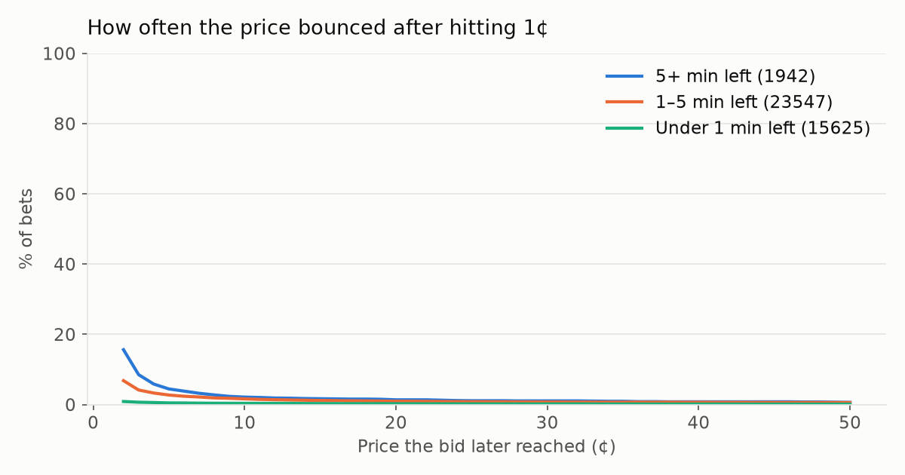
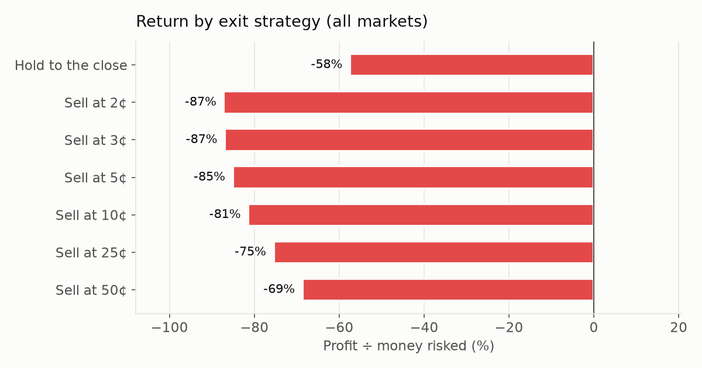
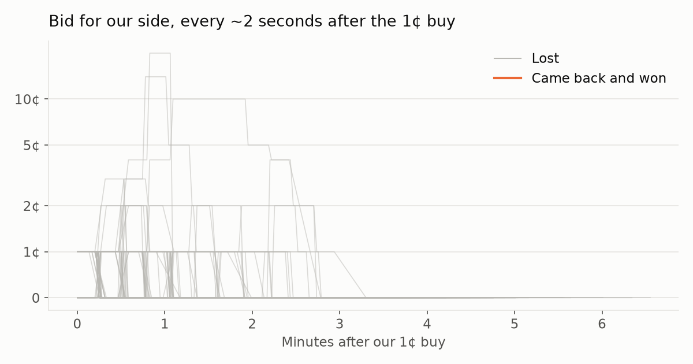

# 15-Minute 1¢ Study

*Updated Thu Nov 12, 2:02 PM MT. Paper money: every Kalshi 15-minute up/down market (crypto, currencies, commodities). Each time the UP or DOWN side hits 1¢ we buy 14 contracts (14¢ + 1¢ fee) and track that side's price every ~2 seconds until the window closes.*

[← Back to all bots](README.md) · [Sports 1¢ Study](STUDY.md)

## Current strategy

🟢 **Trade.** Profitable in both halves of the data over 100+ bets.

1. **Watch** every 15-minute up/down market (Volatility model ≥ 5%).
2. **Buy** the UP or DOWN side the moment it costs **1¢**: **14 contracts** with a 1¢ limit order (15¢ including the fee). One buy per side per window.
3. **Hold** until the 15 minutes are up. No selling.

| Rule | Based on | Hit rate | P&L (14 per buy) | Return | Avg per bet | Earlier half / later half |
|---|---|---|---|---|---|---|
| Volatility model ≥ 5%, hold to the close | 4256 finished bets | 1% | $171.80 | +36% | +4.04¢ | $82.75 / $89.05 |

*Expect about **93 buys a day** (~$14.00/day at risk); max loss per buy **15¢**.*

Runner-up rules

| Rule | Bets | P&L | Return |
|---|---|---|---|
| Momentum model ≥ 5%, hold to the close | 3995 | $99.10 | +23% |
| Volatility model ≥ 2%, hold to the close | 7833 | $37.70 | +4% |
| Momentum model ≥ 2%, hold to the close | 6508 | -$19.75 | -3% |

*Re-picked from the latest data every refresh, using only what's knowable at the moment of buying (market type, time left, price, model readings).*

## Headline

| 1¢ moments caught | Finished | Came back & won | Break-even win rate | Hold-to-close P&L | Best exit so far |
|---|---|---|---|---|---|
| 55094 | 55073 | 212 (0%) | 1.07% | -$3,751.85 (-56%) | Hold to the close: -$3,751.85 (-56%) |

*In play or awaiting result: 9. Commodity markets can take a few hours to settle.*

## Prediction models

*Each model's chance that our side wins, recorded at the moment we bought. Kalshi's price said about 1%. If a model knows better, only buying when it disagrees with the market should improve results.*

- **Volatility model:** random-walk (Black-Scholes) odds from the gap to the target, time left and the last hour's volatility
- **Momentum model:** same, but assumes the last 5 minutes' trend keeps going
- **Mean-reversion model:** same, but assumes the last 5 minutes' trend reverses

*Models cover the crypto markets (live prices from Coinbase). Readings start with the next watch session (about 12:45 AM MT, Sep 28).*

### How accurate is each model?

| Model | Bets scored | Avg chance it gave | Actual win rate | Accuracy vs market | Verdict |
|---|---|---|---|---|---|
| Volatility model | 32957 | 4.7% | 0.4% (133) | -669% | ❌ Worse |
| Momentum model | 32957 | 4.6% | 0.4% (133) | -695% | ❌ Worse |
| Mean-reversion model | 32957 | 8.0% | 0.4% (133) | -810% | ❌ Worse |

*Accuracy vs market compares the model's predictions with Kalshi's 1¢ price (log-loss skill). Positive = the model predicted outcomes better than the market.*

### Would the models have helped?

| Buy only when… | Bets | Won | Hold return | Sell@2¢ | Sell@3¢ | Sell@5¢ |
|---|---|---|---|---|---|---|
| **Any 1¢ (no model)** | 32957 | 133 | -48% | -87% | -87% | -84% |
| Volatility model ≥ 2% | 7833 | 70 | +4% | -77% | -76% | -72% |
| Volatility model ≥ 5% | 4256 | 46 | +36% | -72% | -70% | -67% |
| Volatility model ≥ 10% | 2463 | 28 | +63% | -62% | -61% | -57% |
| Momentum model ≥ 2% | 6508 | 52 | -3% | -78% | -77% | -74% |
| Momentum model ≥ 5% | 3995 | 38 | +23% | -74% | -73% | -69% |
| Momentum model ≥ 10% | 2619 | 25 | +34% | -66% | -65% | -61% |
| Mean-reversion model ≥ 2% | 13592 | 93 | -25% | -82% | -82% | -79% |
| Mean-reversion model ≥ 5% | 9494 | 79 | -8% | -80% | -79% | -77% |
| Mean-reversion model ≥ 10% | 6336 | 56 | +0% | -77% | -77% | -75% |

*Compare each row with the first one: a model helps if its filtered bets earn more.*

## How high did the price bounce?

*Share of bets where the bid for our side later reached at least this much before the close.*

| Market type | Bets | ≥2¢ | ≥3¢ | ≥5¢ | ≥10¢ | ≥25¢ | ≥50¢ |
|---|---|---|---|---|---|---|---|
| Crypto | 33162 | 5% | 3% | 2% | 1% | 1% | 0% |
| Commodities | 13242 | 3% | 2% | 1% | 1% | 0% | 0% |
| Financials | 8669 | 2% | 2% | 1% | 1% | 0% | 0% |
| **All** | 55073 | 4% | 3% | 2% | 1% | 1% | 0% |

## Exit strategies

*Sell the first time our side's bid reaches the target (after Kalshi's selling fee); otherwise hold to the close. Uses our 2-second snapshots, assuming a 14-contract sale fills.*

| Strategy | Hits | Hit rate | P&L | Return | Typical wait |
|---|---|---|---|---|---|
| Hold to the close | 212 | 0% | -$3,751.85 | -56% | — |
| Sell at 2¢ | 2195 | 4% | -$5,855.15 | -87% | 47 sec |
| Sell at 3¢ | 1494 | 3% | -$5,843.19 | -87% | 49 sec |
| Sell at 5¢ | 1031 | 2% | -$5,727.70 | -85% | 63 sec |
| Sell at 10¢ | 626 | 1% | -$5,493.79 | -82% | 65 sec |
| Sell at 25¢ | 330 | 1% | -$5,095.55 | -76% | 82 sec |
| Sell at 50¢ | 217 | 0% | -$4,611.10 | -69% | 1.6 min |

## By time left when it hit 1¢

| Time left in window | Bets | Won | ≥2¢ | ≥5¢ | Hold return | Sell@2¢ | Sell@3¢ |
|---|---|---|---|---|---|---|---|
| Over 10 min | 13 | 0 | 31% | 23% | -100% | -47% | -20% |
| 5–10 min | 2745 | 13 | 11% | 4% | -55% | -81% | -83% |
| 2–5 min | 17788 | 97 | 7% | 3% | -46% | -87% | -86% |
| 1–2 min | 13881 | 46 | 3% | 2% | -63% | -92% | -92% |
| Under 1 min | 20646 | 56 | 1% | 0% | -61% | -85% | -84% |

## By market

| Market | Bets | Won | ≥2¢ | ≥5¢ | Hold return | Sell@2¢ | Sell@3¢ |
|---|---|---|---|---|---|---|---|
| ZEC | 3712 | 17 | 5% | 3% | -40% | -88% | -87% |
| SOL | 3707 | 16 | 4% | 2% | -45% | -87% | -87% |
| HYPE | 3701 | 11 | 5% | 2% | -63% | -89% | -88% |
| BNB | 3692 | 19 | 5% | 2% | -35% | -86% | -85% |
| DOGE | 3687 | 8 | 4% | 2% | -73% | -90% | -90% |
| ETH | 3683 | 16 | 7% | 3% | -46% | -82% | -82% |
| BTC | 3665 | 18 | 5% | 2% | -33% | -87% | -88% |
| NEAR | 3663 | 17 | 5% | 2% | -40% | -85% | -85% |
| XRP | 3652 | 13 | 3% | 1% | -56% | -89% | -89% |
| GOLD | 1991 | 5 | 5% | 2% | -69% | -82% | -84% |
| WTI | 1973 | 7 | 4% | 2% | -57% | -91% | -92% |
| SILVER | 1936 | 9 | 5% | 2% | -45% | -83% | -82% |
| PLATINUM | 1766 | 4 | 3% | 1% | -79% | -96% | -95% |
| EURUSD | 1707 | 6 | 3% | 1% | -67% | -90% | -90% |
| COPPER | 1652 | 6 | 2% | 1% | -66% | -74% | -74% |
| GBPUSD | 1634 | 6 | 2% | 1% | -66% | -96% | -96% |
| NATGAS | 1620 | 9 | 2% | 1% | -48% | -73% | -73% |
| USDJPY | 1606 | 6 | 2% | 1% | -65% | -97% | -96% |
| PALLADIUM | 1583 | 4 | 1% | 1% | -76% | -92% | -92% |
| AUDUSD | 1157 | 6 | 2% | 1% | -52% | -88% | -89% |
| USDCAD | 1114 | 1 | 3% | 1% | -92% | -95% | -96% |
| BRENT | 721 | 0 | 2% | 1% | -100% | -97% | -97% |
| 10YRRATE | 372 | 2 | 4% | 2% | -50% | -68% | -66% |
| 2YRRATE | 357 | 4 | 4% | 2% | +5% | -41% | -40% |
| 30YRRATE | 353 | 0 | 2% | 1% | -100% | -96% | -94% |
| 5YRRATE | 328 | 2 | 4% | 2% | -43% | -93% | -94% |
| INX | 41 | 0 | 0% | 0% | -100% | -100% | -100% |

## UP vs DOWN

| Side | Bets | Won | ≥2¢ | ≥5¢ | Hold return | Sell@2¢ | Sell@3¢ |
|---|---|---|---|---|---|---|---|
| UP (bought YES) | 27996 | 110 | 4% | 2% | -55% | -88% | -88% |
| DOWN (bought NO) | 27077 | 102 | 4% | 2% | -57% | -86% | -86% |

## By how far price had to move (crypto)

*Distance between the coin's live price (Coinbase) and the window's target price when we bought.*

| Gap to target at buy | Bets | Won | ≥2¢ | ≥5¢ | Hold return | Sell@2¢ | Sell@3¢ |
|---|---|---|---|---|---|---|---|
| Under 0.05% | 5233 | 25 | 2% | 1% | -15% | -77% | -77% |
| 0.05–0.1% | 5624 | 20 | 3% | 2% | -45% | -91% | -91% |
| 0.1–0.2% | 8492 | 31 | 5% | 2% | -54% | -89% | -89% |
| 0.2–0.5% | 10000 | 41 | 6% | 3% | -54% | -87% | -86% |
| Over 0.5% | 3805 | 18 | 7% | 3% | -51% | -87% | -87% |

## By time of day

| When (MT) | Bets | Won | ≥2¢ | ≥5¢ | Hold return | Sell@2¢ | Sell@3¢ |
|---|---|---|---|---|---|---|---|
| Night (12–6am MT) | 13478 | 44 | 4% | 2% | -63% | -88% | -88% |
| Morning (6am–12pm) | 13343 | 62 | 4% | 2% | -47% | -85% | -84% |
| Afternoon (12–6pm) | 13291 | 59 | 4% | 2% | -48% | -86% | -86% |
| Evening (6pm–12am) | 14961 | 47 | 4% | 2% | -64% | -89% | -89% |

## Speed & liquidity

| Metric | Typical (median) |
|---|---|
| Our buy vs Kalshi's first 1¢ trade | 26 sec |
| Contracts traded at 1¢ after our buy (room to buy more) | 4,823 |
| Time from buy to best bounce (bounced bets) | 51 sec |
| Price snapshots per bet | 42 |

## Latest bets

| When (MT) | Market | Side | Time left | Gap | Peak bid | Result | Hold P&L |
|---|---|---|---|---|---|---|---|
| 11/12 1:59:51 PM | BNB | DOWN | 8 sec | -0.014% | 0¢ | ❌ Lost | -$0.15 |
| 11/12 1:59:51 PM | WTI | UP | 8 sec | — | 1¢ | ❌ Lost | -$0.15 |
| 11/12 1:59:51 PM | USDJPY | DOWN | 8 sec | — | 0¢ | ❌ Lost | -$0.15 |
| 11/12 1:59:51 PM | SILVER | UP | 8 sec | — | 0¢ | ❌ Lost | -$0.15 |
| 11/12 1:59:35 PM | BTC | UP | 24 sec | -0.028% | 0¢ | ❌ Lost | -$0.15 |
| 11/12 1:59:35 PM | ZEC | DOWN | 24 sec | +0.003% | 0¢ | ❌ Lost | -$0.15 |
| 11/12 1:59:35 PM | USDCAD | UP | 24 sec | — | 50¢ | ✅ Won | $13.85 |
| 11/12 1:59:21 PM | DOGE | UP | 39 sec | -0.093% | 0¢ | ❌ Lost | $0.00 |
| 11/12 1:59:21 PM | XRP | UP | 39 sec | -0.164% | 0¢ | ❌ Lost | $0.00 |
| 11/12 1:59:21 PM | SOL | UP | 39 sec | -0.217% | 0¢ | ❌ Lost | $0.00 |
| 11/12 1:58:48 PM | GBPUSD | DOWN | 71 sec | — | 0¢ | ❌ Lost | -$0.15 |
| 11/12 1:58:48 PM | EURUSD | DOWN | 71 sec | — | 0¢ | ❌ Lost | -$0.15 |
| 11/12 1:58:32 PM | ETH | UP | 87 sec | -0.142% | 0¢ | ❌ Lost | -$0.15 |
| 11/12 1:58:16 PM | 2YRRATE | DOWN | 1.7 min | — | 0¢ | ❌ Lost | -$0.15 |
| 11/12 1:58:16 PM | 30YRRATE | DOWN | 1.7 min | — | 0¢ | ❌ Lost | -$0.15 |
| 11/12 1:58:16 PM | 5YRRATE | DOWN | 1.7 min | — | 0¢ | ❌ Lost | -$0.15 |
| 11/12 1:58:16 PM | NEAR | UP | 1.7 min | -0.396% | 1¢ | ❌ Lost | -$0.15 |
| 11/12 1:58:16 PM | 10YRRATE | DOWN | 1.7 min | — | 0¢ | ❌ Lost | -$0.15 |
| 11/12 1:57:26 PM | COPPER | UP | 2.6 min | — | 0¢ | ❌ Lost | -$0.15 |
| 11/12 1:55:33 PM | GOLD | UP | 4.5 min | — | 2¢ | ❌ Lost | -$0.15 |
| 11/12 1:55:17 PM | HYPE | DOWN | 4.7 min | +0.458% | 4¢ | ❌ Lost | -$0.15 |
| 11/12 1:44:50 PM | DOGE | DOWN | 9 sec | +0.106% | 0¢ | ❌ Lost | $0.00 |
| 11/12 1:44:50 PM | 2YRRATE | UP | 9 sec | — | 0¢ | ❌ Lost | -$0.15 |
| 11/12 1:44:50 PM | BTC | DOWN | 9 sec | +0.001% | 0¢ | ❌ Lost | $0.00 |
| 11/12 1:44:50 PM | SOL | DOWN | 9 sec | +0.007% | 0¢ | ❌ Lost | $0.00 |
| 11/12 1:44:50 PM | ETH | UP | 9 sec | -0.020% | 0¢ | ❌ Lost | $0.00 |
| 11/12 1:44:50 PM | BRENT | DOWN | 9 sec | — | 0¢ | ❌ Lost | -$0.15 |
| 11/12 1:44:50 PM | 10YRRATE | DOWN | 9 sec | — | 0¢ | ❌ Lost | -$0.15 |
| 11/12 1:44:34 PM | INX | UP | 25 sec | — | 0¢ | ❌ Lost | -$0.15 |
| 11/12 1:44:34 PM | BNB | DOWN | 25 sec | -0.011% | 1¢ | ❌ Lost | -$0.15 |

## Raw data

- [fifteen/bets.csv](fifteen/bets.csv) — one row per bet with every metric
- `fifteen/snaps/` — our ~2-second bid/ask snapshots for every open bet, one file per day
- `fifteen/ticks/` — every Kalshi trade in each market from 1 min before our buy to the close
- [fifteen/status.json](fifteen/status.json) — bot health
