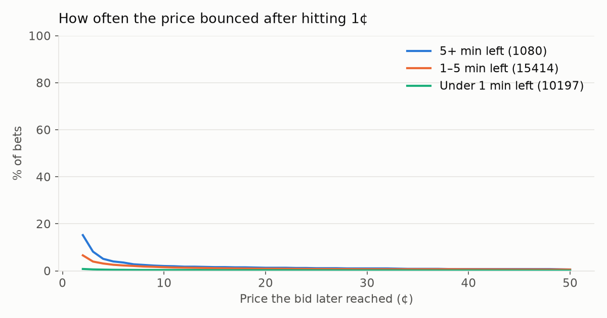
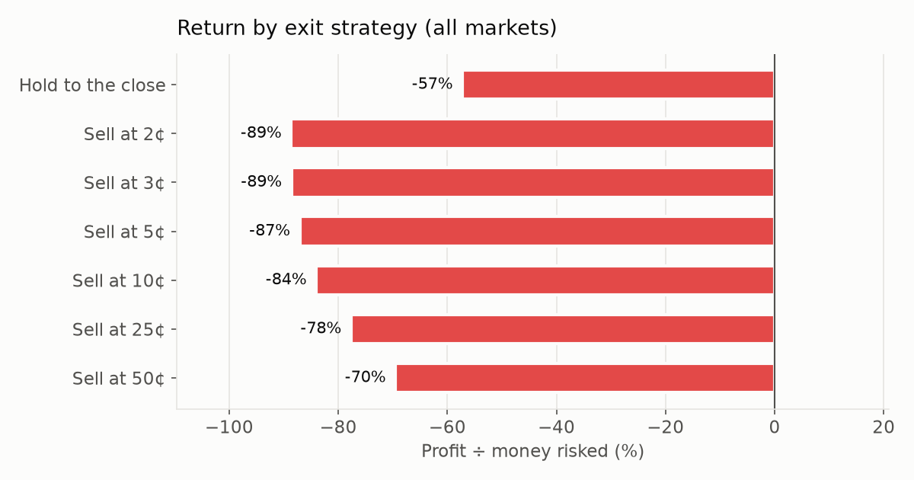
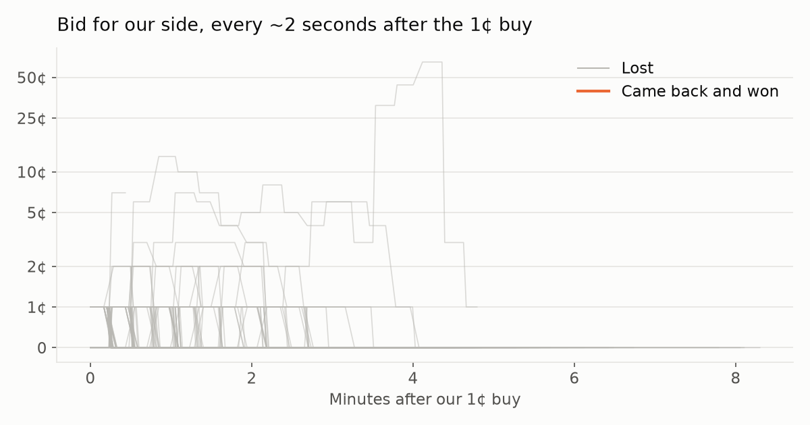

# 15-Minute 1¢ Study

*Updated Sat Oct 10, 3:45 PM MT. Paper money: every Kalshi 15-minute up/down market (crypto, currencies, commodities). Each time the UP or DOWN side hits 1¢ we buy 14 contracts (14¢ + 1¢ fee) and track that side's price every ~2 seconds until the window closes.*

[← Back to all bots](README.md) · [Sports 1¢ Study](STUDY.md)

## Current strategy

🟡 **Unproven.** Profitable overall, but not in both the earlier and later halves of the data.

1. **Watch** every 15-minute up/down market (Volatility model ≥ 5%).
2. **Buy** the UP or DOWN side the moment it costs **1¢**: **14 contracts** with a 1¢ limit order (15¢ including the fee). One buy per side per window.
3. **Hold** until the 15 minutes are up. No selling.

| Rule | Based on | Hit rate | P&L (14 per buy) | Return | Avg per bet | Earlier half / later half |
|---|---|---|---|---|---|---|
| Volatility model ≥ 5%, hold to the close | 1008 finished bets | 1% | $30.20 | +28% | +3.00¢ | -$11.55 / $41.75 |

*Expect about **80 buys a day** (~$11.97/day at risk); max loss per buy **15¢**.*

Runner-up rules

| Rule | Bets | P&L | Return |
|---|---|---|---|
| Momentum model ≥ 5%, hold to the close | 976 | $6.85 | +7% |
| 5+ min left, hold to the close | 390 | -$1.60 | -3% |
| Volatility model ≥ 5%, sell at 50¢ | 1008 | -$14.30 | -13% |

*Re-picked from the latest data every refresh, using only what's knowable at the moment of buying (market type, time left, price, model readings).*

## Headline

| 1¢ moments caught | Finished | Came back & won | Break-even win rate | Hold-to-close P&L | Best exit so far |
|---|---|---|---|---|---|
| 13995 | 13986 | 56 (0%) | 1.07% | -$906.95 (-54%) | Hold to the close: -$906.95 (-54%) |

*In play or awaiting result: 8. Commodity markets can take a few hours to settle.*

## Prediction models

*Each model's chance that our side wins, recorded at the moment we bought. Kalshi's price said about 1%. If a model knows better, only buying when it disagrees with the market should improve results.*

- **Volatility model:** random-walk (Black-Scholes) odds from the gap to the target, time left and the last hour's volatility
- **Momentum model:** same, but assumes the last 5 minutes' trend keeps going
- **Mean-reversion model:** same, but assumes the last 5 minutes' trend reverses

*Models cover the crypto markets (live prices from Coinbase). Readings start with the next watch session (about 12:45 AM MT, Sep 28).*

### How accurate is each model?

| Model | Bets scored | Avg chance it gave | Actual win rate | Accuracy vs market | Verdict |
|---|---|---|---|---|---|
| Volatility model | 9141 | 4.3% | 0.4% (39) | -627% | ❌ Worse |
| Momentum model | 9141 | 4.3% | 0.4% (39) | -655% | ❌ Worse |
| Mean-reversion model | 9141 | 7.0% | 0.4% (39) | -727% | ❌ Worse |

*Accuracy vs market compares the model's predictions with Kalshi's 1¢ price (log-loss skill). Positive = the model predicted outcomes better than the market.*

### Would the models have helped?

| Buy only when… | Bets | Won | Hold return | Sell@2¢ | Sell@3¢ | Sell@5¢ |
|---|---|---|---|---|---|---|
| **Any 1¢ (no model)** | 9141 | 39 | -46% | -88% | -88% | -86% |
| Volatility model ≥ 2% | 1795 | 14 | -10% | -76% | -76% | -73% |
| Volatility model ≥ 5% | 1008 | 10 | +28% | -69% | -68% | -65% |
| Volatility model ≥ 10% | 631 | 8 | +84% | -56% | -56% | -51% |
| Momentum model ≥ 2% | 1587 | 11 | -16% | -77% | -79% | -77% |
| Momentum model ≥ 5% | 976 | 8 | +7% | -72% | -73% | -71% |
| Momentum model ≥ 10% | 674 | 6 | +26% | -64% | -65% | -61% |
| Mean-reversion model ≥ 2% | 3195 | 23 | -22% | -85% | -85% | -81% |
| Mean-reversion model ≥ 5% | 2167 | 17 | -13% | -82% | -82% | -77% |
| Mean-reversion model ≥ 10% | 1436 | 13 | +5% | -81% | -81% | -76% |

*Compare each row with the first one: a model helps if its filtered bets earn more.*

## How high did the price bounce?

*Share of bets where the bid for our side later reached at least this much before the close.*

| Market type | Bets | ≥2¢ | ≥3¢ | ≥5¢ | ≥10¢ | ≥25¢ | ≥50¢ |
|---|---|---|---|---|---|---|---|
| Crypto | 9339 | 4% | 3% | 2% | 1% | 1% | 0% |
| Commodities | 3444 | 2% | 1% | 1% | 1% | 0% | 0% |
| Financials | 1203 | 2% | 2% | 1% | 1% | 0% | 0% |
| **All** | 13986 | 3% | 2% | 2% | 1% | 1% | 0% |

## Exit strategies

*Sell the first time our side's bid reaches the target (after Kalshi's selling fee); otherwise hold to the close. Uses our 2-second snapshots, assuming a 14-contract sale fills.*

| Strategy | Hits | Hit rate | P&L | Return | Typical wait |
|---|---|---|---|---|---|
| Hold to the close | 56 | 0% | -$906.95 | -54% | — |
| Sell at 2¢ | 475 | 3% | -$1,525.45 | -90% | 33 sec |
| Sell at 3¢ | 316 | 2% | -$1,525.71 | -90% | 47 sec |
| Sell at 5¢ | 231 | 2% | -$1,498.80 | -89% | 50 sec |
| Sell at 10¢ | 151 | 1% | -$1,423.14 | -84% | 64 sec |
| Sell at 25¢ | 86 | 1% | -$1,308.29 | -77% | 81 sec |
| Sell at 50¢ | 57 | 0% | -$1,166.20 | -69% | 1.6 min |

## By time left when it hit 1¢

| Time left in window | Bets | Won | ≥2¢ | ≥5¢ | Hold return | Sell@2¢ | Sell@3¢ |
|---|---|---|---|---|---|---|---|
| Over 10 min | 4 | 0 | 75% | 50% | -100% | +30% | +95% |
| 5–10 min | 386 | 4 | 11% | 3% | -2% | -81% | -86% |
| 2–5 min | 4522 | 28 | 6% | 3% | -39% | -89% | -89% |
| 1–2 min | 3667 | 15 | 3% | 2% | -56% | -94% | -93% |
| Under 1 min | 5407 | 9 | 1% | 0% | -76% | -90% | -90% |

## By market

| Market | Bets | Won | ≥2¢ | ≥5¢ | Hold return | Sell@2¢ | Sell@3¢ |
|---|---|---|---|---|---|---|---|
| ZEC | 1045 | 6 | 4% | 3% | -30% | -90% | -90% |
| HYPE | 1044 | 3 | 4% | 2% | -64% | -90% | -89% |
| BNB | 1043 | 5 | 4% | 2% | -42% | -91% | -92% |
| DOGE | 1042 | 2 | 4% | 2% | -76% | -92% | -91% |
| ETH | 1037 | 8 | 5% | 3% | -5% | -89% | -88% |
| SOL | 1035 | 1 | 3% | 1% | -88% | -94% | -93% |
| BTC | 1032 | 4 | 5% | 2% | -49% | -88% | -91% |
| NEAR | 1031 | 6 | 6% | 3% | -24% | -74% | -75% |
| XRP | 1030 | 6 | 2% | 1% | -27% | -83% | -83% |
| GOLD | 568 | 0 | 4% | 1% | -100% | -92% | -94% |
| SILVER | 555 | 1 | 3% | 1% | -79% | -94% | -94% |
| WTI | 529 | 3 | 3% | 1% | -35% | -94% | -96% |
| COPPER | 490 | 0 | 1% | 0% | -100% | -99% | -99% |
| PLATINUM | 451 | 0 | 0% | 0% | -100% | -100% | -99% |
| NATGAS | 431 | 3 | 3% | 2% | -35% | -95% | -93% |
| PALLADIUM | 420 | 1 | 1% | 0% | -78% | -98% | -99% |
| EURUSD | 412 | 3 | 3% | 2% | -32% | -72% | -71% |
| GBPUSD | 389 | 1 | 3% | 2% | -76% | -96% | -95% |
| USDJPY | 353 | 3 | 1% | 1% | -21% | -98% | -97% |
| AUDUSD | 25 | 0 | 0% | 0% | -100% | -100% | -100% |
| USDCAD | 24 | 0 | 0% | 0% | -100% | -100% | -100% |

## UP vs DOWN

| Side | Bets | Won | ≥2¢ | ≥5¢ | Hold return | Sell@2¢ | Sell@3¢ |
|---|---|---|---|---|---|---|---|
| UP (bought YES) | 7036 | 29 | 3% | 2% | -52% | -89% | -89% |
| DOWN (bought NO) | 6950 | 27 | 3% | 1% | -55% | -91% | -92% |

## By how far price had to move (crypto)

*Distance between the coin's live price (Coinbase) and the window's target price when we bought.*

| Gap to target at buy | Bets | Won | ≥2¢ | ≥5¢ | Hold return | Sell@2¢ | Sell@3¢ |
|---|---|---|---|---|---|---|---|
| Under 0.05% | 1604 | 9 | 2% | 1% | -6% | -72% | -72% |
| 0.05–0.1% | 1644 | 5 | 3% | 1% | -56% | -92% | -92% |
| 0.1–0.2% | 2384 | 8 | 4% | 2% | -58% | -91% | -92% |
| 0.2–0.5% | 2634 | 14 | 5% | 3% | -42% | -89% | -88% |
| Over 0.5% | 1070 | 5 | 6% | 2% | -52% | -88% | -90% |

## By time of day

| When (MT) | Bets | Won | ≥2¢ | ≥5¢ | Hold return | Sell@2¢ | Sell@3¢ |
|---|---|---|---|---|---|---|---|
| Night (12–6am MT) | 3525 | 19 | 4% | 2% | -38% | -85% | -86% |
| Morning (6am–12pm) | 3425 | 18 | 4% | 2% | -40% | -91% | -91% |
| Afternoon (12–6pm) | 3256 | 9 | 3% | 1% | -67% | -90% | -90% |
| Evening (6pm–12am) | 3780 | 10 | 3% | 1% | -70% | -94% | -94% |

## Speed & liquidity

| Metric | Typical (median) |
|---|---|
| Our buy vs Kalshi's first 1¢ trade | 25 sec |
| Contracts traded at 1¢ after our buy (room to buy more) | 4,290 |
| Time from buy to best bounce (bounced bets) | 48 sec |
| Price snapshots per bet | 42 |

## Latest bets

| When (MT) | Market | Side | Time left | Gap | Peak bid | Result | Hold P&L |
|---|---|---|---|---|---|---|---|
| 10/10 3:44:31 PM | DOGE | UP | 28 sec | -0.095% | 0¢ | ❌ Lost | -$0.15 |
| 10/10 3:44:31 PM | BNB | UP | 28 sec | -0.073% | 0¢ | ❌ Lost | $0.00 |
| 10/10 3:44:31 PM | ETH | DOWN | 28 sec | +0.051% | 0¢ | ❌ Lost | -$0.15 |
| 10/10 3:44:31 PM | SOL | DOWN | 28 sec | +0.018% | 0¢ | ❌ Lost | -$0.15 |
| 10/10 3:43:58 PM | BTC | DOWN | 61 sec | +0.025% | 0¢ | ❌ Lost | -$0.15 |
| 10/10 3:43:10 PM | HYPE | UP | 1.8 min | -0.131% | 1¢ | ❌ Lost | -$0.15 |
| 10/10 3:43:10 PM | XRP | UP | 1.8 min | -0.121% | 1¢ | ❌ Lost | -$0.15 |
| 10/10 3:42:04 PM | ZEC | UP | 2.9 min | -0.249% | 1¢ | In play | — |
| 10/10 3:40:59 PM | NEAR | UP | 4.0 min | -0.526% | 1¢ | In play | — |
| 10/10 3:29:57 PM | DOGE | DOWN | 3 sec | -0.057% | 0¢ | ❌ Lost | $0.00 |
| 10/10 3:29:25 PM | ETH | DOWN | 35 sec | +0.013% | 1¢ | ❌ Lost | -$0.15 |
| 10/10 3:29:25 PM | NEAR | DOWN | 35 sec | -0.017% | 0¢ | ❌ Lost | -$0.15 |
| 10/10 3:29:10 PM | BNB | DOWN | 49 sec | -0.047% | 0¢ | ❌ Lost | -$0.15 |
| 10/10 3:29:10 PM | SOL | UP | 49 sec | -0.049% | 0¢ | ❌ Lost | -$0.15 |
| 10/10 3:28:53 PM | ZEC | DOWN | 66 sec | +0.116% | 0¢ | ❌ Lost | $0.00 |
| 10/10 3:28:53 PM | HYPE | DOWN | 66 sec | +0.073% | 0¢ | ❌ Lost | -$0.15 |
| 10/10 3:28:53 PM | BTC | DOWN | 66 sec | +0.033% | 0¢ | ❌ Lost | $0.00 |
| 10/10 3:28:37 PM | XRP | DOWN | 82 sec | +0.050% | 1¢ | ❌ Lost | -$0.15 |
| 10/10 3:14:58 PM | NEAR | DOWN | 1 sec | +0.004% | 0¢ | ❌ Lost | $0.00 |
| 10/10 3:14:42 PM | ZEC | DOWN | 17 sec | -0.003% | 0¢ | ❌ Lost | $0.00 |
| 10/10 3:14:26 PM | BTC | UP | 33 sec | -0.028% | 0¢ | ❌ Lost | $0.00 |
| 10/10 3:14:26 PM | DOGE | UP | 33 sec | -0.086% | 0¢ | ❌ Lost | -$0.15 |
| 10/10 3:14:10 PM | HYPE | UP | 50 sec | -0.089% | 1¢ | ❌ Lost | -$0.15 |
| 10/10 3:14:10 PM | SOL | UP | 50 sec | -0.033% | 0¢ | ❌ Lost | -$0.15 |
| 10/10 3:13:53 PM | BNB | UP | 66 sec | -0.095% | 0¢ | ❌ Lost | $0.00 |
| 10/10 3:13:37 PM | ETH | UP | 82 sec | -0.069% | 1¢ | ❌ Lost | -$0.15 |
| 10/10 3:13:37 PM | XRP | UP | 82 sec | -0.107% | 0¢ | ❌ Lost | -$0.15 |
| 10/10 2:59:44 PM | ZEC | UP | 15 sec | -0.028% | 0¢ | ❌ Lost | $0.00 |
| 10/10 2:59:44 PM | BNB | DOWN | 15 sec | -0.016% | 0¢ | ❌ Lost | -$0.15 |
| 10/10 2:59:44 PM | DOGE | UP | 15 sec | -0.058% | 0¢ | ❌ Lost | $0.00 |

## Raw data

- [fifteen/bets.csv](fifteen/bets.csv) — one row per bet with every metric
- `fifteen/snaps/` — our ~2-second bid/ask snapshots for every open bet, one file per day
- `fifteen/ticks/` — every Kalshi trade in each market from 1 min before our buy to the close
- [fifteen/status.json](fifteen/status.json) — bot health
