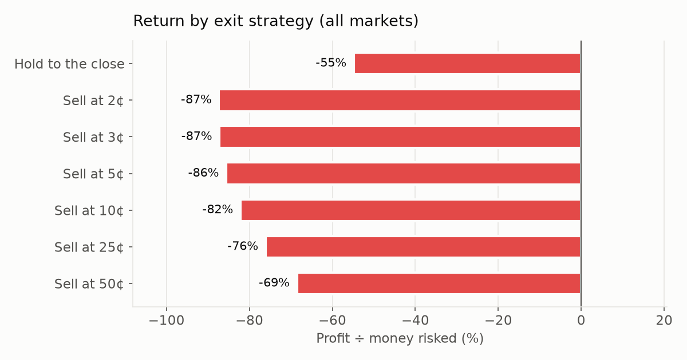

# 15-Minute 1¢ Study

*Updated Wed Nov 25, 10:32 PM MT. Paper money: every Kalshi 15-minute up/down market (crypto, currencies, commodities). Each time the UP or DOWN side hits 1¢ we buy 14 contracts (14¢ + 1¢ fee) and track that side's price every ~2 seconds until the window closes.*

[← Back to all bots](README.md) · [Sports 1¢ Study](STUDY.md)

## Current strategy

🟢 **Trade.** Profitable in both halves of the data over 100+ bets.

1. **Watch** every 15-minute up/down market (Volatility model ≥ 5%).
2. **Buy** the UP or DOWN side the moment it costs **1¢**: **14 contracts** with a 1¢ limit order (15¢ including the fee). One buy per side per window.
3. **Hold** until the 15 minutes are up. No selling.

| Rule | Based on | Hit rate | P&L (14 per buy) | Return | Avg per bet | Earlier half / later half |
|---|---|---|---|---|---|---|
| Volatility model ≥ 5%, hold to the close | 4923 finished bets | 1% | $206.35 | +39% | +4.19¢ | $85.75 / $120.60 |

*Expect about **84 buys a day** (~$12.53/day at risk); max loss per buy **15¢**.*

Runner-up rules

| Rule | Bets | P&L | Return |
|---|---|---|---|
| Momentum model ≥ 5%, hold to the close | 4667 | $105.65 | +21% |
| Volatility model ≥ 2%, hold to the close | 9175 | $42.30 | +4% |
| Momentum model ≥ 2%, hold to the close | 7632 | -$39.05 | -5% |

*Re-picked from the latest data every refresh, using only what's knowable at the moment of buying (market type, time left, price, model readings).*

## Headline

| 1¢ moments caught | Finished | Came back & won | Break-even win rate | Hold-to-close P&L | Best exit so far |
|---|---|---|---|---|---|
| 68150 | 68116 | 256 (0%) | 1.07% | -$4,662.25 (-57%) | Hold to the close: -$4,662.25 (-57%) |

*In play or awaiting result: 6. Commodity markets can take a few hours to settle.*

## Prediction models

*Each model's chance that our side wins, recorded at the moment we bought. Kalshi's price said about 1%. If a model knows better, only buying when it disagrees with the market should improve results.*

- **Volatility model:** random-walk (Black-Scholes) odds from the gap to the target, time left and the last hour's volatility
- **Momentum model:** same, but assumes the last 5 minutes' trend keeps going
- **Mean-reversion model:** same, but assumes the last 5 minutes' trend reverses

*Models cover the crypto markets (live prices from Coinbase). Readings start with the next watch session (about 12:45 AM MT, Sep 28).*

### How accurate is each model?

| Model | Bets scored | Avg chance it gave | Actual win rate | Accuracy vs market | Verdict |
|---|---|---|---|---|---|
| Volatility model | 40312 | 4.5% | 0.4% (165) | -650% | ❌ Worse |
| Momentum model | 40312 | 4.4% | 0.4% (165) | -673% | ❌ Worse |
| Mean-reversion model | 40312 | 7.9% | 0.4% (165) | -790% | ❌ Worse |

*Accuracy vs market compares the model's predictions with Kalshi's 1¢ price (log-loss skill). Positive = the model predicted outcomes better than the market.*

### Would the models have helped?

| Buy only when… | Bets | Won | Hold return | Sell@2¢ | Sell@3¢ | Sell@5¢ |
|---|---|---|---|---|---|---|
| **Any 1¢ (no model)** | 40312 | 165 | -47% | -87% | -87% | -85% |
| Volatility model ≥ 2% | 9175 | 81 | +4% | -77% | -76% | -73% |
| Volatility model ≥ 5% | 4923 | 53 | +39% | -73% | -72% | -68% |
| Volatility model ≥ 10% | 2847 | 32 | +66% | -65% | -63% | -60% |
| Momentum model ≥ 2% | 7632 | 59 | -5% | -79% | -79% | -76% |
| Momentum model ≥ 5% | 4667 | 43 | +21% | -75% | -75% | -71% |
| Momentum model ≥ 10% | 3040 | 28 | +33% | -68% | -68% | -64% |
| Mean-reversion model ≥ 2% | 16417 | 113 | -24% | -82% | -82% | -80% |
| Mean-reversion model ≥ 5% | 11430 | 93 | -9% | -80% | -79% | -77% |
| Mean-reversion model ≥ 10% | 7588 | 66 | -0% | -78% | -77% | -75% |

*Compare each row with the first one: a model helps if its filtered bets earn more.*

## How high did the price bounce?

*Share of bets where the bid for our side later reached at least this much before the close.*

| Market type | Bets | ≥2¢ | ≥3¢ | ≥5¢ | ≥10¢ | ≥25¢ | ≥50¢ |
|---|---|---|---|---|---|---|---|
| Crypto | 40518 | 5% | 3% | 2% | 1% | 1% | 1% |
| Commodities | 16248 | 3% | 2% | 1% | 1% | 0% | 0% |
| Financials | 11350 | 2% | 2% | 1% | 1% | 0% | 0% |
| **All** | 68116 | 4% | 3% | 2% | 1% | 1% | 0% |

## Exit strategies

*Sell the first time our side's bid reaches the target (after Kalshi's selling fee); otherwise hold to the close. Uses our 2-second snapshots, assuming a 14-contract sale fills.*

| Strategy | Hits | Hit rate | P&L | Return | Typical wait |
|---|---|---|---|---|---|
| Hold to the close | 256 | 0% | -$4,662.25 | -57% | — |
| Sell at 2¢ | 2788 | 4% | -$7,227.37 | -88% | 47 sec |
| Sell at 3¢ | 1871 | 3% | -$7,222.56 | -88% | 48 sec |
| Sell at 5¢ | 1264 | 2% | -$7,102.65 | -86% | 62 sec |
| Sell at 10¢ | 772 | 1% | -$6,828.93 | -83% | 65 sec |
| Sell at 25¢ | 416 | 1% | -$6,309.29 | -77% | 80 sec |
| Sell at 50¢ | 266 | 0% | -$5,708.75 | -69% | 1.6 min |

## By time left when it hit 1¢

| Time left in window | Bets | Won | ≥2¢ | ≥5¢ | Hold return | Sell@2¢ | Sell@3¢ |
|---|---|---|---|---|---|---|---|
| Over 10 min | 13 | 0 | 31% | 23% | -100% | -47% | -20% |
| 5–10 min | 3517 | 17 | 11% | 4% | -54% | -81% | -83% |
| 2–5 min | 22089 | 116 | 7% | 3% | -48% | -86% | -87% |
| 1–2 min | 16991 | 58 | 3% | 2% | -62% | -92% | -92% |
| Under 1 min | 25506 | 65 | 1% | 0% | -63% | -87% | -87% |

## By market

| Market | Bets | Won | ≥2¢ | ≥5¢ | Hold return | Sell@2¢ | Sell@3¢ |
|---|---|---|---|---|---|---|---|
| ZEC | 4531 | 20 | 5% | 2% | -41% | -88% | -87% |
| HYPE | 4524 | 16 | 5% | 2% | -54% | -89% | -88% |
| SOL | 4518 | 20 | 4% | 2% | -43% | -86% | -86% |
| BNB | 4510 | 22 | 5% | 2% | -38% | -86% | -85% |
| DOGE | 4508 | 12 | 4% | 2% | -66% | -89% | -89% |
| ETH | 4502 | 19 | 7% | 3% | -47% | -82% | -82% |
| BTC | 4482 | 24 | 6% | 2% | -26% | -86% | -87% |
| NEAR | 4477 | 18 | 5% | 2% | -47% | -86% | -86% |
| XRP | 4466 | 16 | 4% | 2% | -54% | -89% | -88% |
| GOLD | 2402 | 8 | 5% | 2% | -59% | -83% | -84% |
| WTI | 2384 | 8 | 4% | 2% | -59% | -91% | -92% |
| SILVER | 2346 | 9 | 5% | 2% | -54% | -83% | -84% |
| PLATINUM | 2130 | 5 | 3% | 1% | -78% | -95% | -95% |
| EURUSD | 2079 | 7 | 3% | 1% | -69% | -91% | -90% |
| GBPUSD | 2023 | 8 | 2% | 1% | -63% | -96% | -96% |
| COPPER | 2017 | 6 | 2% | 1% | -72% | -78% | -78% |
| USDJPY | 1977 | 6 | 2% | 1% | -72% | -96% | -96% |
| NATGAS | 1974 | 10 | 2% | 1% | -53% | -77% | -77% |
| PALLADIUM | 1916 | 4 | 1% | 1% | -81% | -93% | -93% |
| AUDUSD | 1546 | 7 | 2% | 1% | -58% | -90% | -90% |
| USDCAD | 1452 | 1 | 3% | 1% | -94% | -95% | -96% |
| BRENT | 1079 | 1 | 2% | 1% | -91% | -96% | -97% |
| 10YRRATE | 557 | 2 | 3% | 1% | -66% | -78% | -76% |
| 30YRRATE | 518 | 0 | 3% | 1% | -100% | -95% | -93% |
| 2YRRATE | 515 | 4 | 4% | 2% | -28% | -57% | -57% |
| 5YRRATE | 506 | 2 | 4% | 2% | -63% | -94% | -95% |
| INX | 139 | 1 | 2% | 1% | -33% | -96% | -96% |
| USDMXN | 38 | 0 | 0% | 0% | -100% | -100% | -100% |

## UP vs DOWN

| Side | Bets | Won | ≥2¢ | ≥5¢ | Hold return | Sell@2¢ | Sell@3¢ |
|---|---|---|---|---|---|---|---|
| UP (bought YES) | 34780 | 132 | 4% | 2% | -56% | -88% | -88% |
| DOWN (bought NO) | 33336 | 124 | 4% | 2% | -57% | -87% | -87% |

## By how far price had to move (crypto)

*Distance between the coin's live price (Coinbase) and the window's target price when we bought.*

| Gap to target at buy | Bets | Won | ≥2¢ | ≥5¢ | Hold return | Sell@2¢ | Sell@3¢ |
|---|---|---|---|---|---|---|---|
| Under 0.05% | 5882 | 25 | 2% | 1% | -22% | -79% | -78% |
| 0.05–0.1% | 6430 | 26 | 3% | 2% | -35% | -91% | -91% |
| 0.1–0.2% | 10043 | 36 | 5% | 2% | -53% | -89% | -89% |
| 0.2–0.5% | 12775 | 56 | 7% | 3% | -50% | -86% | -86% |
| Over 0.5% | 5379 | 24 | 7% | 3% | -53% | -86% | -87% |

## By time of day

| When (MT) | Bets | Won | ≥2¢ | ≥5¢ | Hold return | Sell@2¢ | Sell@3¢ |
|---|---|---|---|---|---|---|---|
| Night (12–6am MT) | 16330 | 50 | 4% | 2% | -65% | -88% | -88% |
| Morning (6am–12pm) | 16129 | 82 | 4% | 2% | -42% | -86% | -85% |
| Afternoon (12–6pm) | 16751 | 73 | 4% | 2% | -48% | -87% | -87% |
| Evening (6pm–12am) | 18906 | 51 | 4% | 2% | -69% | -89% | -89% |

## Speed & liquidity

| Metric | Typical (median) |
|---|---|
| Our buy vs Kalshi's first 1¢ trade | 26 sec |
| Contracts traded at 1¢ after our buy (room to buy more) | 5,087 |
| Time from buy to best bounce (bounced bets) | 51 sec |
| Price snapshots per bet | 42 |

## Latest bets

| When (MT) | Market | Side | Time left | Gap | Peak bid | Result | Hold P&L |
|---|---|---|---|---|---|---|---|
| 11/25 10:29:48 PM | USDCAD | DOWN | 12 sec | — | 0¢ | ❌ Lost | -$0.15 |
| 11/25 10:29:48 PM | GBPUSD | UP | 12 sec | — | 0¢ | ❌ Lost | -$0.15 |
| 11/25 10:29:28 PM | WTI | UP | 31 sec | — | 1¢ | ❌ Lost | -$0.15 |
| 11/25 10:28:56 PM | BRENT | UP | 63 sec | — | 0¢ | ❌ Lost | -$0.15 |
| 11/25 10:28:40 PM | AUDUSD | UP | 80 sec | — | 0¢ | ❌ Lost | -$0.15 |
| 11/25 10:28:19 PM | NATGAS | DOWN | 1.7 min | — | 0¢ | ❌ Lost | -$0.15 |
| 11/25 10:28:19 PM | ZEC | DOWN | 1.7 min | +0.238% | 1¢ | ❌ Lost | -$0.15 |
| 11/25 10:28:03 PM | COPPER | DOWN | 1.9 min | — | 0¢ | ❌ Lost | -$0.15 |
| 11/25 10:27:47 PM | PLATINUM | DOWN | 2.2 min | — | 0¢ | ❌ Lost | -$0.15 |
| 11/25 10:27:32 PM | DOGE | DOWN | 2.5 min | +0.226% | 1¢ | ❌ Lost | -$0.15 |
| 11/25 10:27:32 PM | GOLD | DOWN | 2.5 min | — | 0¢ | ❌ Lost | $0.00 |
| 11/25 10:27:32 PM | USDJPY | DOWN | 2.5 min | — | 0¢ | ❌ Lost | -$0.15 |
| 11/25 10:27:12 PM | HYPE | DOWN | 2.8 min | +0.191% | 1¢ | ❌ Lost | -$0.15 |
| 11/25 10:26:56 PM | ETH | DOWN | 3.1 min | +0.157% | 1¢ | ❌ Lost | -$0.15 |
| 11/25 10:26:56 PM | BNB | DOWN | 3.1 min | +0.172% | 1¢ | ❌ Lost | -$0.15 |
| 11/25 10:26:56 PM | PALLADIUM | DOWN | 3.1 min | — | 0¢ | ❌ Lost | -$0.15 |
| 11/25 10:26:40 PM | XRP | DOWN | 3.3 min | +0.292% | 1¢ | ❌ Lost | -$0.15 |
| 11/25 10:26:40 PM | BTC | DOWN | 3.3 min | +0.184% | 1¢ | ❌ Lost | -$0.15 |
| 11/25 10:26:40 PM | SOL | DOWN | 3.3 min | +0.288% | 1¢ | ❌ Lost | -$0.15 |
| 11/25 10:26:25 PM | SILVER | DOWN | 3.6 min | — | 1¢ | ❌ Lost | -$0.15 |
| 11/25 10:24:28 PM | NEAR | DOWN | 5.5 min | +0.807% | 1¢ | ❌ Lost | -$0.15 |
| 11/25 10:14:44 PM | USDJPY | UP | 16 sec | — | 0¢ | ❌ Lost | -$0.15 |
| 11/25 10:14:25 PM | PLATINUM | DOWN | 34 sec | — | 0¢ | ❌ Lost | -$0.15 |
| 11/25 10:14:25 PM | SILVER | DOWN | 34 sec | — | 1¢ | ❌ Lost | -$0.15 |
| 11/25 10:14:25 PM | SOL | DOWN | 34 sec | +0.030% | 0¢ | ❌ Lost | $0.00 |
| 11/25 10:14:09 PM | XRP | DOWN | 50 sec | +0.146% | 0¢ | ❌ Lost | $0.00 |
| 11/25 10:14:09 PM | DOGE | UP | 50 sec | -0.048% | 0¢ | ❌ Lost | $0.00 |
| 11/25 10:13:53 PM | PALLADIUM | DOWN | 66 sec | — | 0¢ | ❌ Lost | -$0.15 |
| 11/25 10:13:53 PM | COPPER | DOWN | 66 sec | — | 0¢ | ❌ Lost | -$0.15 |
| 11/25 10:13:37 PM | BTC | UP | 83 sec | -0.093% | 1¢ | ❌ Lost | -$0.15 |

## Raw data

- [fifteen/bets.csv](fifteen/bets.csv) — one row per bet with every metric
- `fifteen/snaps/` — our ~2-second bid/ask snapshots for every open bet, one file per day
- `fifteen/ticks/` — every Kalshi trade in each market from 1 min before our buy to the close
- [fifteen/status.json](fifteen/status.json) — bot health
