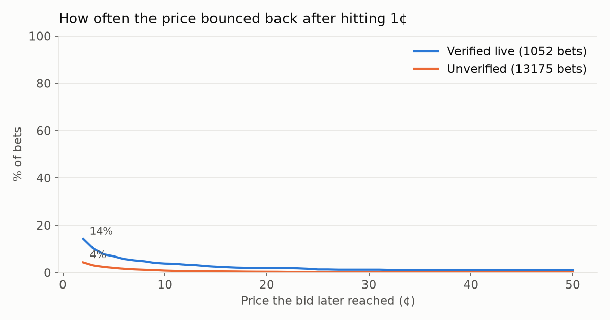
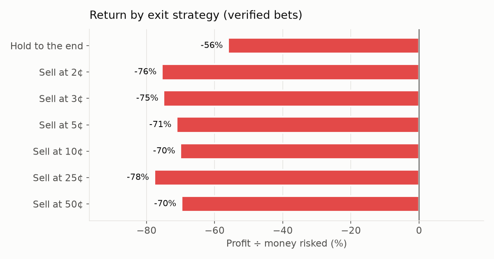
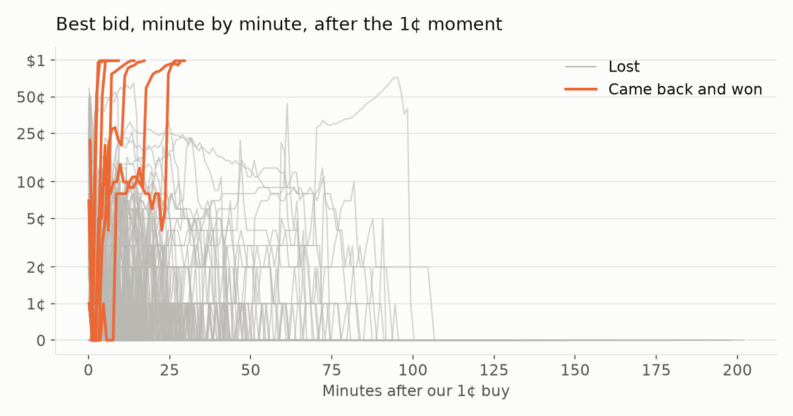

# 1¢ Study

*Updated Tue Oct 13, 1:30 PM MT. Paper money: each bet buys 14 contracts at 1¢ (14¢ + 1¢ fee). Prices come from Kalshi's own trade records and minute-by-minute bid/ask.*

[← Back to all bots](README.md)

## Current strategy

🟡 **Unproven.** Profitable overall, but not in both the earlier and later halves of the data.

1. **Watch** every live game in **ESPN win probability ≥ 2%**.
2. **Buy** when a team or player's YES price hits **1¢**: **14 contracts** with a 1¢ limit order (cost 15¢ including the fee). One buy per outcome.
3. **Hold** every position until the game ends. No selling.

| Rule | Based on | Hit rate | P&L (14 per buy) | Return | Avg per bet | Earlier half / later half |
|---|---|---|---|---|---|---|
| ESPN win probability ≥ 2%, hold to the end | 44 finished bets | 2% | $7.40 | +112% | +16.82¢ | -$3.30 / $10.70 |

*Expect about **3 buys a day**, roughly **$0.48/day** at risk; max loss per buy **15¢**.*

Runner-up rules

| Rule | Bets | P&L | Return |
|---|---|---|---|
| ESPN win probability ≥ 2%, sell at 50¢ | 44 | $0.15 | +2% |
| ESPN win probability ≥ 2%, sell at 25¢ | 44 | -$3.29 | -50% |
| ESPN win probability ≥ 2%, sell at 3¢ | 44 | -$4.26 | -65% |

*Re-picked automatically from the latest data every refresh. Rules only use what's knowable at the moment of buying (league, price, model reading), not hindsight like how the game ended.*

## Headline (verified live bets)

| 1¢ moments (all leagues) | Finished (verified) | Came back & won | Break-even win rate | Hold-to-end P&L | Best exit so far |
|---|---|---|---|---|---|
| 12001 | 935 | 6 (1%) | 1.1% | -$56.25 (-40%) | Hold to the end: -$56.25 (-40%) |

*In play right now: 37. Verified = ESPN confirmed the game was still being played when we bought. Unverified leagues are shown separately below.*

## Prediction models

*Each model's chance that our side wins, recorded at the moment we bought. Kalshi's price said about 1%. If a model knows better, only buying when it disagrees with the market should improve results.*

- **ESPN win probability:** ESPN's live in-game win-probability model (NFL, NBA, WNBA, college football & basketball)

*Readings start with the next watch session (about 10:30 PM MT, Sep 27). Leagues ESPN doesn't model show no reading.*

### How accurate is each model?

| Model | Bets scored | Avg chance it gave | Actual win rate | Accuracy vs market | Verdict |
|---|---|---|---|---|---|
| ESPN win probability | 211 | 3.2% | 0.5% (1) | -34% | ❌ Worse |

*Accuracy vs market compares the model's predictions with Kalshi's 1¢ price (log-loss skill). Positive = the model predicted outcomes better than the market.*

### Would the models have helped?

| Buy only when… | Bets | Won | Hold return | Sell@2¢ | Sell@3¢ | Sell@5¢ |
|---|---|---|---|---|---|---|
| **Any 1¢ (no model)** | 211 | 1 | -56% | -75% | -74% | -73% |
| ESPN win probability ≥ 2% | 44 | 1 | +112% | -68% | -65% | -80% |
| ESPN win probability ≥ 5% | 19 | 1 | +391% | -82% | -73% | -77% |
| ESPN win probability ≥ 10% | 13 | 1 | +618% | -73% | -60% | -67% |

*Compare each row with the first one: a model helps if its filtered bets earn more.*

## How high did the price bounce?

*Share of bets where someone later bid at least this much before the game ended.*

| Group | Bets | ≥2¢ | ≥3¢ | ≥5¢ | ≥10¢ | ≥25¢ | ≥50¢ |
|---|---|---|---|---|---|---|---|
| Verified | 935 | 15% | 10% | 7% | 4% | 1% | 1% |
| Unverified | 11029 | 4% | 3% | 2% | 1% | 0% | 0% |

## Exit strategies

*Sell the first time the bid reaches the target (after Kalshi's selling fee); if it never does, hold to the end. Based on the best bid each minute, assuming a 14-contract sale would fill.*

| Strategy | Hits | Hit rate | P&L | Return |
|---|---|---|---|---|
| Hold to the end | 6 | 1% | -$56.25 | -40% |
| Sell at 2¢ | 138 | 15% | -$104.37 | -74% |
| Sell at 3¢ | 97 | 10% | -$102.42 | -73% |
| Sell at 5¢ | 66 | 7% | -$97.35 | -69% |
| Sell at 10¢ | 35 | 4% | -$94.40 | -67% |
| Sell at 25¢ | 13 | 1% | -$97.22 | -69% |
| Sell at 50¢ | 9 | 1% | -$79.50 | -57% |

## By league

| League | Verified | Bets | Won | ≥2¢ | ≥5¢ | Hold return | Sell@2¢ return | Typical time left |
|---|---|---|---|---|---|---|---|---|
| eSoccer Game | ✘ | 3494 | 0 | 0% | 0% | -100% | -100% | 2 min |
| TT Elite Series Match | ✘ | 1304 | 0 | 1% | 1% | -100% | -98% | 5 min |
| ITF Women's Match | ✘ | 597 | 0 | 12% | 6% | -100% | -79% | 4 min |
| Counter-Strike 2 Game | ✘ | 564 | 1 | 4% | 3% | -83% | -93% | 11 min |
| ITF Men's Match | ✘ | 524 | 1 | 10% | 6% | -82% | -82% | 5 min |
| Challenger ATP  | ✘ | 403 | 2 | 10% | 3% | -54% | -83% | 5 min |
| eBasketball Game | ✘ | 371 | 1 | 0% | 0% | -75% | -74% | 2 min |
| TT Star Series Match | ✘ | 247 | 1 | 2% | 2% | -62% | -96% | 4 min |
| College Football Game | partly | 188 | 2 | 13% | 6% | -1% | -78% | 31 min |
| Darts Match | ✘ | 174 | 0 | 1% | 1% | -100% | -99% | 9 min |
| Women's College Volleyball Match | ✘ | 156 | 2 | 7% | 3% | +20% | -88% | 105 min |
| UEFA Nations League Game | ✔ | 140 | 0 | 9% | 5% | -100% | -84% | 7 min |
| Men's T20 Cricket Match | ✘ | 130 | 1 | 14% | 4% | -28% | -76% | 21 min |
| Challenger WTA | ✘ | 127 | 0 | 13% | 6% | -100% | -78% | 8 min |
| League of Legends Game | ✘ | 126 | 0 | 7% | 2% | -100% | -88% | 11 min |
| Serie C Game | ✘ | 111 | 1 | 5% | 2% | -16% | -92% | 6 min |
| CONCACAF Nations League Game | partly | 108 | 2 | 20% | 7% | +73% | -65% | 19 min |
| Dota 2 Game | ✘ | 89 | 0 | 2% | 2% | -100% | -96% | 29 min |
| NHL Game | ✔ | 89 | 0 | 16% | 7% | -100% | -73% | 5 min |
| Brasileiro Serie B Game | ✘ | 64 | 0 | 5% | 2% | -100% | -92% | 11 min |
| International Friendly Game | partly | 59 | 1 | 15% | 7% | +58% | -74% | 17 min |
| English National League Game | ✘ | 59 | 0 | 7% | 5% | -100% | -88% | 10 min |
| AHL Game | ✘ | 59 | 0 | 3% | 2% | -100% | -94% | 6 min |
| R6 Game | ✘ | 56 | 0 | 5% | 2% | -100% | -91% | 9 min |
| KHL Game | ✘ | 53 | 0 | 4% | 2% | -100% | -93% | 5 min |
| Ettan Game | ✘ | 53 | 0 | 8% | 2% | -100% | -87% | 5 min |
| Argentina Primera Division Game | ✘ | 53 | 0 | 15% | 6% | -100% | -74% | 8 min |
| Argentine Nacional B Game | ✘ | 51 | 0 | 10% | 10% | -100% | -83% | 10 min |
| AFCON Game Winner | ✘ | 49 | 1 | 16% | 4% | +90% | -72% | 14 min |
| KBO Game | ✘ | 49 | 0 | 8% | 6% | -100% | -86% | 5 min |
| Overwatch Game | ✘ | 49 | 0 | 4% | 0% | -100% | -93% | 5 min |
| FIFA Women's Game | ✘ | 47 | 1 | 15% | 9% | +99% | -74% | 39 min |
| Liga DIMAYOR Game | ✘ | 45 | 1 | 11% | 4% | +107% | -81% | 6 min |
| Brasileiro Serie A Game | partly | 45 | 1 | 22% | 13% | +107% | -61% | 7 min |
| LaLiga 2 Game | partly | 44 | 0 | 16% | 7% | -100% | -72% | 8 min |
| USL Championship Game | partly | 41 | 0 | 12% | 2% | -100% | -79% | 6 min |
| Liga Leumit Game | ✘ | 40 | 0 | 2% | 2% | -100% | -96% | 14 min |
| Japan J2 League Game | ✘ | 40 | 0 | 12% | 2% | -100% | -78% | 8 min |
| Major League Soccer Game | partly | 39 | 1 | 18% | 5% | +139% | -69% | 6 min |
| NBA Game | ✔ | 39 | 0 | 13% | 3% | -100% | -78% | 5 min |
| Uruguay Primera Division Game | ✘ | 38 | 0 | 8% | 5% | -100% | -86% | 10 min |
| LNBP Basketball Game | ✘ | 38 | 0 | 8% | 0% | -100% | -86% | 14 min |
| ATP Tennis Match | ✘ | 37 | 0 | 11% | 5% | -100% | -81% | 3 min |
| WTA Tennis Match | ✘ | 35 | 0 | 11% | 0% | -100% | -80% | 4 min |
| National League Game | ✘ | 35 | 1 | 3% | 3% | +167% | -95% | 5 min |
| Eerste Divisie Game | ✘ | 35 | 0 | 6% | 6% | -100% | -90% | 11 min |
| Slovakian 2. Liga Game | ✘ | 34 | 0 | 6% | 6% | -100% | -90% | 111 min |
| Liiga Game | ✘ | 34 | 0 | 0% | 0% | -100% | -100% | 5 min |
| ELH Game | ✘ | 33 | 0 | 0% | 0% | -100% | -100% | 4 min |
| EuroCup Basketball Game | ✘ | 31 | 0 | 3% | 0% | -100% | -94% | 10 min |
| NFL Game | ✔ | 31 | 1 | 19% | 6% | +201% | -66% | 4 min |
| Liga Expansion Game | ✘ | 31 | 0 | 6% | 6% | -100% | -89% | 10 min |
| German 3. Liga Game | ✘ | 30 | 0 | 13% | 3% | -100% | -77% | 7 min |
| Euroleague Game | ✘ | 29 | 0 | 21% | 3% | -100% | -64% | 14 min |
| EFL Trophy Game | ✘ | 29 | 0 | 7% | 7% | -100% | -88% | 47 min |
| SHL Game | ✘ | 28 | 0 | 0% | 0% | -100% | -100% | 5 min |
| DEL Game | ✘ | 28 | 0 | 0% | 0% | -100% | -100% | 4 min |
| Japan NPB Game | ✘ | 27 | 0 | 0% | 0% | -100% | -100% | 2 min |
| Valorant game winner | ✘ | 27 | 0 | 7% | 4% | -100% | -87% | 16 min |
| Chinese Basketball Association Game  | ✘ | 27 | 0 | 0% | 0% | -100% | -100% | 11 min |
| Tweede Divisie Game | ✘ | 26 | 0 | 0% | 0% | -100% | -100% | 9 min |
| China League 1 Game | ✘ | 25 | 0 | 12% | 8% | -100% | -79% | 6 min |
| Rugby French 14 Match | ✘ | 22 | 0 | 0% | 0% | -100% | -100% | 8 min |
| Mobile Legends Bang Bang Game | ✘ | 22 | 0 | 0% | 0% | -100% | -100% | 4 min |
| TFF 1. Lig Game | ✘ | 21 | 0 | 14% | 5% | -100% | -75% | 8 min |
| NWSL Game | ✔ | 20 | 0 | 15% | 0% | -100% | -74% | 10 min |
| Finland Korisliiga Game | ✘ | 20 | 0 | 0% | 0% | -100% | -100% | 9 min |
| Peru Liga 1 Game | ✘ | 20 | 0 | 25% | 20% | -100% | -57% | 7 min |
| Italy Serie A2 Game | ✘ | 20 | 0 | 0% | 0% | -100% | -100% | 5 min |
| Japan J League Game | ✘ | 20 | 0 | 15% | 5% | -100% | -74% | 12 min |
| AFC Champions League Game | ✘ | 20 | 0 | 10% | 0% | -100% | -83% | 10 min |
| Liga MX Game | ✔ | 19 | 0 | 16% | 16% | -100% | -73% | 1 min |
| Professional Baseball Game | partly | 19 | 0 | 11% | 5% | -100% | -82% | 2 min |
| Champions League Women's Game | partly | 19 | 1 | 21% | 11% | +391% | -64% | 20 min |
| Bundesliga Basketball Game | ✘ | 19 | 0 | 11% | 5% | -100% | -82% | 12 min |
| Adriatic ABA Game | ✘ | 19 | 0 | 0% | 0% | -100% | -100% | 9 min |
| LNB Elite 2 Game | ✘ | 19 | 0 | 0% | 0% | -100% | -100% | 8 min |
| Polish Ekstraklasa Game | ✘ | 19 | 0 | 16% | 5% | -100% | -73% | 11 min |
| Serie A Game | ✔ | 19 | 0 | 11% | 11% | -100% | -82% | 11 min |
| Sweden SBL Game | ✘ | 18 | 0 | 0% | 0% | -100% | -100% | 15 min |
| Bundesliga 2 Game | ✔ | 18 | 0 | 17% | 11% | -100% | -71% | 8 min |
| Eredivisie Game | ✔ | 18 | 0 | 0% | 0% | -100% | -100% | 2 min |
| Ligue 2 Game | ✘ | 18 | 0 | 17% | 17% | -100% | -71% | 7 min |
| Belgian Pro League Game | ✘ | 18 | 0 | 6% | 0% | -100% | -90% | 10 min |
| Ligue 1 Game | ✔ | 18 | 0 | 17% | 11% | -100% | -71% | 10 min |
| La Liga Game | ✔ | 18 | 0 | 44% | 33% | -100% | -23% | 9 min |
| APF Division de Honor Game | ✘ | 17 | 0 | 12% | 0% | -100% | -80% | 5 min |
| Canadian Premier League | ✘ | 17 | 1 | 24% | 24% | +449% | -59% | 29 min |
| Spain Liga ACB Game | ✘ | 17 | 0 | 12% | 6% | -100% | -80% | 17 min |
| College Hockey Game | ✘ | 17 | 0 | 0% | 0% | -100% | -100% | 7 min |
| Australia NBL Game | ✘ | 16 | 0 | 6% | 0% | -100% | -89% | 7 min |
| Men's ODI Cricket Match | ✘ | 16 | 0 | 6% | 0% | -100% | -89% | 22 min |
| Czech NBL Game | ✘ | 16 | 0 | 0% | 0% | -100% | -100% | 11 min |
| LNB Elite Game | ✘ | 16 | 0 | 0% | 0% | -100% | -100% | 12 min |
| Chile Liga de Primera Game | ✘ | 16 | 0 | 12% | 0% | -100% | -78% | 12 min |
| EFL League One Game | ✔ | 16 | 0 | 12% | 0% | -100% | -78% | 4 min |
| Italy Serie A Game | ✘ | 16 | 0 | 6% | 6% | -100% | -89% | 6 min |
| Korea K-League 2 Game | ✘ | 16 | 0 | 12% | 6% | -100% | -78% | 6 min |
| Indonesia Super League Game | ✘ | 16 | 0 | 12% | 0% | -100% | -78% | 10 min |
| Thai League 1 Game | ✘ | 16 | 0 | 19% | 0% | -100% | -68% | 7 min |
| Eliteserien Game | ✘ | 16 | 0 | 19% | 12% | -100% | -68% | 9 min |
| Turkish Super Lig Game | ✘ | 16 | 0 | 12% | 0% | -100% | -78% | 14 min |
| Serie B Game | ✘ | 16 | 0 | 12% | 6% | -100% | -78% | 15 min |
| Ecuador Liga Pro Game | ✘ | 16 | 0 | 12% | 0% | -100% | -78% | 6 min |
| Liga Portugal Game | ✘ | 16 | 0 | 6% | 0% | -100% | -89% | 10 min |
| Copa Del Rey Game | ✘ | 15 | 0 | 7% | 7% | -100% | -88% | 34 min |
| Chinese Super League Game | ✘ | 15 | 0 | 13% | 7% | -100% | -77% | 22 min |
| Czech National Football League Game | ✘ | 15 | 0 | 20% | 20% | -100% | -65% | 12 min |
| Czech First League Game | ✘ | 15 | 0 | 13% | 0% | -100% | -77% | 11 min |
| Allsvenskan Game | ✘ | 15 | 0 | 20% | 20% | -100% | -65% | 14 min |
| Brasileiro Serie C Game | ✘ | 14 | 0 | 14% | 7% | -100% | -75% | 5 min |
| Austria BSL Game | ✘ | 14 | 0 | 7% | 0% | -100% | -88% | 5 min |
| England Women's Super League Game | ✘ | 14 | 0 | 7% | 0% | -100% | -88% | 40 min |
| Saudi Pro League Game | ✘ | 14 | 0 | 21% | 21% | -100% | -63% | 15 min |
| Bolivia Premier Division Game | ✘ | 14 | 0 | 7% | 0% | -100% | -88% | 5 min |
| English Premier League Game | ✔ | 14 | 0 | 7% | 7% | -100% | -88% | 7 min |
| Israeli Premier League Game | ✘ | 14 | 0 | 0% | 0% | -100% | -100% | 6 min |
| Super League Greece Game | ✘ | 14 | 0 | 21% | 7% | -100% | -63% | 13 min |
| Venezuela Liga FUTVE game | ✘ | 14 | 0 | 14% | 7% | -100% | -75% | 10 min |
| Egyptian Premier League Game | ✘ | 14 | 0 | 0% | 0% | -100% | -100% | 5 min |
| Women's Pro Basketball Game | ✔ | 13 | 0 | 23% | 8% | -100% | -60% | 6 min |
| Turkey BSL Game | ✘ | 13 | 0 | 0% | 0% | -100% | -100% | 9 min |
| Slovakia SBL Game | ✘ | 12 | 0 | 0% | 0% | -100% | -100% | 21 min |
| Serie A Femminile Game | ✘ | 12 | 0 | 0% | 0% | -100% | -100% | 24 min |
| Vietnam V-League 1 Game | ✘ | 12 | 0 | 0% | 0% | -100% | -100% | 10 min |
| Korea K League Game | ✘ | 12 | 0 | 42% | 17% | -100% | -28% | 14 min |
| Danish Superliga Game | ✘ | 12 | 0 | 8% | 0% | -100% | -86% | 13 min |
| Serbian SuperLiga Game | ✘ | 12 | 0 | 0% | 0% | -100% | -100% | 20 min |
| Swiss Super League Game | ✘ | 12 | 0 | 8% | 0% | -100% | -86% | 28 min |
| Women's ODI Cricket Match | ✘ | 11 | 0 | 18% | 9% | -100% | -68% | 50 min |
| Russia VTB United Game | ✘ | 11 | 0 | 9% | 0% | -100% | -84% | 16 min |
| Croatia Premijer Liga Game | ✘ | 11 | 0 | 0% | 0% | -100% | -100% | 21 min |
| Finnish Ykkosliiga Game | ✘ | 11 | 1 | 9% | 9% | +748% | -84% | 15 min |
| EFL Championship Game | ✔ | 11 | 0 | 0% | 0% | -100% | -100% | 2 min |
| Women's T20 Match | ✘ | 10 | 0 | 20% | 10% | -100% | -65% | 24 min |
| Eredivisie Vrouwen Game | ✘ | 10 | 0 | 10% | 10% | -100% | -83% | 22 min |
| Faroe Islands Premier League Game | ✘ | 10 | 0 | 10% | 0% | -100% | -83% | 86 min |
| LKL Lithuania Game | ✘ | 9 | 0 | 0% | 0% | -100% | -100% | 5 min |
| Croatia HNL Game | ✘ | 9 | 0 | 22% | 11% | -100% | -61% | 16 min |
| Bundesliga Game | ✔ | 9 | 1 | 22% | 22% | +937% | -61% | 13 min |
| Latvian Virsliga Game | ✘ | 9 | 0 | 11% | 0% | -100% | -81% | 10 min |
| Slovenian Prva Liga Game | ✘ | 9 | 0 | 22% | 11% | -100% | -61% | 14 min |
| Slovenia 1. SKL Game | ✘ | 8 | 0 | 12% | 12% | -100% | -78% | 11 min |
| England Super League Basketball Game | ✘ | 8 | 0 | 0% | 0% | -100% | -100% | 9 min |
| CFL Game | ✘ | 8 | 0 | 0% | 0% | -100% | -100% | 8 min |
| Singapore Premier League Game | ✘ | 8 | 0 | 0% | 0% | -100% | -100% | 17 min |
| Scottish Premiership Game | ✘ | 7 | 0 | 0% | 0% | -100% | -100% | 39 min |
| Professional Football Game | ✔ | 6 | 0 | 17% | 0% | -100% | -71% | 6 min |
| United Rugby Championship Match | ✘ | 6 | 0 | 0% | 0% | -100% | -100% | 5 min |
| PREM Rugby Match | ✘ | 6 | 0 | 0% | 0% | -100% | -100% | 7 min |
| UEFA Champions League Game | ✔ | 4 | 0 | 0% | 0% | -100% | -100% | 7 min |
| FIBA Europe Cup Game | ✘ | 3 | 0 | 0% | 0% | -100% | -100% | 33 min |
| Slovakian Cup Game | ✘ | 2 | 0 | 0% | 0% | -100% | -100% | 14 min |
| Club Friendlies | ✘ | 2 | 0 | 0% | 0% | -100% | -100% | 12 min |
| USL Cup Game | ✘ | 2 | 0 | 0% | 0% | -100% | -100% | 2 min |
| England Super League Rugby Match | ✘ | 1 | 0 | 0% | 0% | -100% | -100% | 5 min |
| Rugby NRL Match | ✘ | 1 | 0 | 0% | 0% | -100% | -100% | 7 min |
| Powerslap Match Winner | ✘ | 1 | 0 | 100% | 100% | -100% | +73% | 436 min |
| Korea KBL Game | ✘ | 1 | 0 | 0% | 0% | -100% | -100% | 78 min |

## By time left when it hit 1¢

| Time left in game | Bets | ≥2¢ | ≥5¢ | Won | Sell@2¢ return |
|---|---|---|---|---|---|
| Under 5 min | 394 | 6% | 2% | 0% | -89% |
| 5–15 min | 191 | 18% | 7% | 2% | -69% |
| 15–30 min | 134 | 31% | 17% | 1% | -46% |
| 30–60 min | 112 | 16% | 10% | 0% | -72% |
| Over 60 min | 98 | 20% | 13% | 0% | -65% |

## Speed & liquidity

| Metric | Typical (median) |
|---|---|
| Our buy vs Kalshi's first 1¢ trade | 47 sec later |
| Time from 1¢ to its best bounce (bounced bets) | 6 min |
| Contracts traded at 1¢ after our buy (how much you could buy) | 0 |

## Latest bets

*Times are UTC. Peak = best bid after our buy.*

| When | League | Pick | Verified | Situation at 1¢ | Peak | Result | Hold P&L |
|---|---|---|---|---|---|---|---|
| 10-13 19:30 | Counter-Strike 2 Game | ZOTIX | ✘ | — | — | In play | — |
| 10-13 19:28 | Challenger ATP  | Gonzalo Bueno | ✘ | — | — | In play | — |
| 10-13 19:27 | EFL Championship Game | Watford | ✔ | 42' · WAT 0 - CAR 3 | — | In play | — |
| 10-13 19:25 | ITF Men's Match | Hiroki Sakagawa | ✘ | — | — | In play | — |
| 10-13 19:25 | ITF Women's Match | Kennedy Drenser-Hagmann | ✘ | — | 0¢ | ❌ Lost | -$0.15 |
| 10-13 19:24 | Counter-Strike 2 Game | IMAPROBLEM | ✘ | — | — | In play | — |
| 10-13 19:24 | eSoccer Game | Tie | ✘ | — | — | In play | — |
| 10-13 19:23 | eSoccer Game | FC Bayern (Dzen) | ✘ | — | — | In play | — |
| 10-13 19:23 | FIFA Women's Game | Reg Time: Tie | ✘ | — | — | In play | — |
| 10-13 19:22 | Counter-Strike 2 Game | Regnum4Games | ✘ | — | — | In play | — |
| 10-13 19:22 | eBasketball Game | New York Knicks (Barry) | ✘ | — | 0¢ | ❌ Lost | -$0.15 |
| 10-13 19:21 | Dota 2 Game | Dawn Bulls | ✘ | — | — | In play | — |
| 10-13 19:21 | eSoccer Game | Tie | ✘ | — | — | In play | — |
| 10-13 19:21 | TT Star Series Match | Amiri Nia Soroosh | ✘ | — | — | In play | — |
| 10-13 19:21 | eSoccer Game | Crystal Palace (Nate) | ✘ | — | — | In play | — |
| 10-13 19:21 | eSoccer Game | Tie | ✘ | — | — | In play | — |
| 10-13 19:20 | eSoccer Game | France (Mei) | ✘ | — | — | In play | — |
| 10-13 19:20 | FIFA Women's Game | Reg Time: Tie | ✘ | — | — | In play | — |
| 10-13 19:20 | eSoccer Game | Tie | ✘ | — | — | In play | — |
| 10-13 19:19 | eSoccer Game | Everton (Rendeto) | ✘ | — | — | In play | — |
| 10-13 19:18 | eBasketball Game | Brooklyn Nets (Mick) | ✘ | — | 0¢ | ❌ Lost | -$0.15 |
| 10-13 19:18 | ITF Women's Match | Sofia Elena Cabezas Dominguez | ✘ | — | 0¢ | ❌ Lost | -$0.15 |
| 10-13 19:18 | Counter-Strike 2 Game | Revise | ✘ | — | 0¢ | ❌ Lost | -$0.15 |
| 10-13 19:18 | eSoccer Game | Spain (Lotta) | ✘ | — | 0¢ | ❌ Lost | -$0.15 |
| 10-13 19:18 | eSoccer Game | Tie | ✘ | — | 0¢ | ❌ Lost | -$0.15 |
| 10-13 19:16 | Counter-Strike 2 Game | aimers | ✘ | — | 0¢ | ❌ Lost | -$0.15 |
| 10-13 19:13 | ITF Women's Match | Avery Alexander | ✘ | — | — | In play | — |
| 10-13 19:12 | ITF Men's Match | Matei Cristian Onofrei | ✘ | — | — | In play | — |
| 10-13 19:12 | Euroleague Game | BC Zalgiris Kaunas | ✘ | — | — | In play | — |
| 10-13 19:11 | Counter-Strike 2 Game | menszczysni | ✘ | — | 0¢ | ❌ Lost | -$0.15 |

## Raw data

- [study/bets.csv](study/bets.csv) — one row per bet with every metric
- `study/ticks/` — every Kalshi trade from the first 1¢ trade to the end, per bet
- `study/candles/` — minute-by-minute bid / ask / volume, per bet
