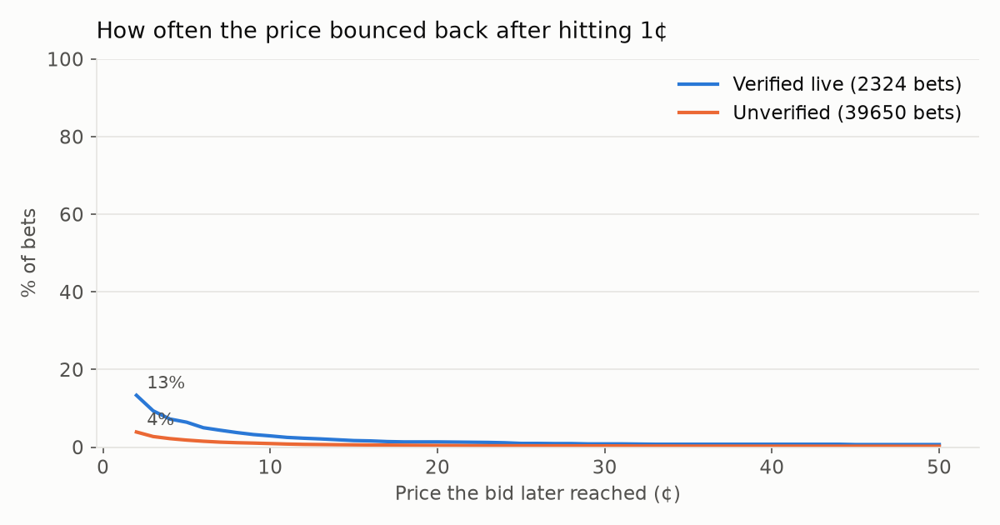
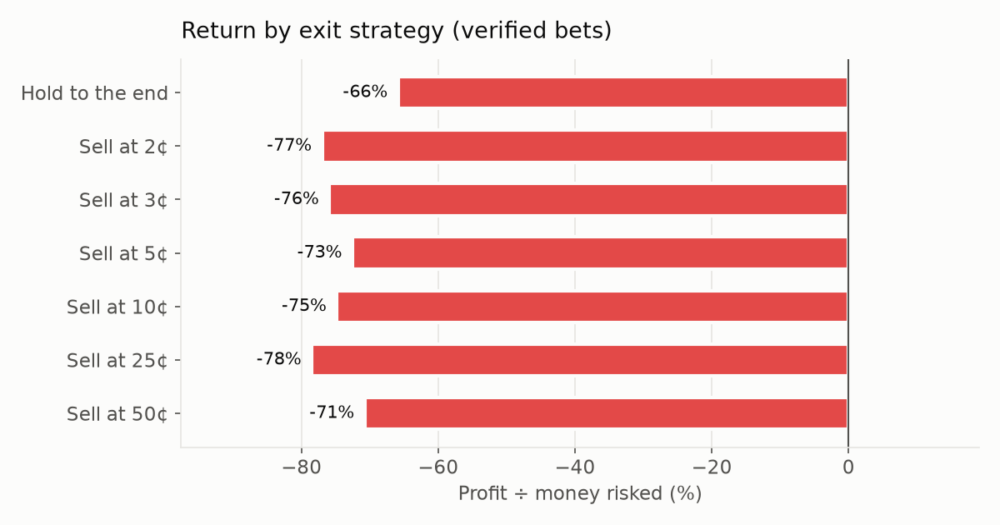
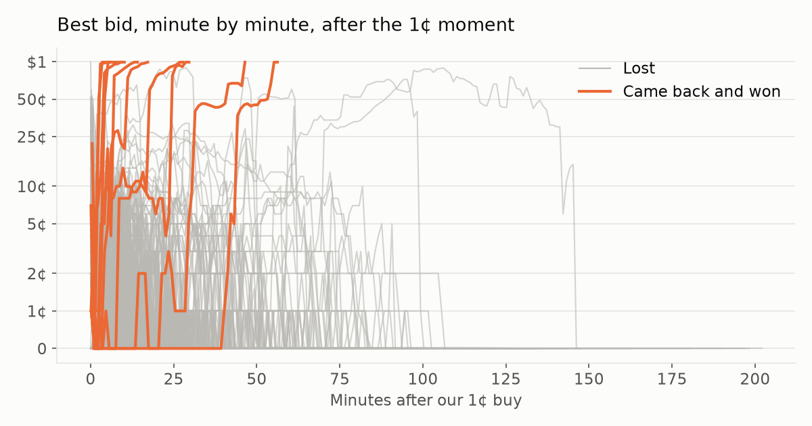

# 1¢ Study

*Updated Sat Nov 7, 12:36 PM MT. Paper money: each bet buys 14 contracts at 1¢ (14¢ + 1¢ fee). Prices come from Kalshi's own trade records and minute-by-minute bid/ask.*

[← Back to all bots](README.md)

## Current strategy

🟡 **Unproven.** Profitable overall, but not in both the earlier and later halves of the data.

1. **Watch** every live game in **ESPN win probability ≥ 5%**.
2. **Buy** when a team or player's YES price hits **1¢**: **14 contracts** with a 1¢ limit order (cost 15¢ including the fee). One buy per outcome.
3. **Hold** every position until the game ends. No selling.

| Rule | Based on | Hit rate | P&L (14 per buy) | Return | Avg per bet | Earlier half / later half |
|---|---|---|---|---|---|---|
| ESPN win probability ≥ 5%, hold to the end | 52 finished bets | 2% | $6.20 | +79% | +11.92¢ | $10.10 / -$3.90 |

*Expect about **1 buys a day**, roughly **$0.22/day** at risk; max loss per buy **15¢**.*

Runner-up rules

| Rule | Bets | P&L | Return |
|---|---|---|---|
| ESPN win probability ≥ 5%, sell at 50¢ | 52 | -$1.05 | -13% |
| ESPN win probability ≥ 5%, sell at 25¢ | 52 | -$1.18 | -15% |
| ESPN win probability ≥ 2%, hold to the end | 122 | -$4.30 | -23% |

*Re-picked automatically from the latest data every refresh. Rules only use what's knowable at the moment of buying (league, price, model reading), not hindsight like how the game ended.*

## Headline (verified live bets)

| 1¢ moments (all leagues) | Finished (verified) | Came back & won | Break-even win rate | Hold-to-end P&L | Best exit so far |
|---|---|---|---|---|---|
| 51794 | 2842 | 12 (0%) | 1.1% | -$258.30 (-61%) | Hold to the end: -$258.30 (-61%) |

*In play right now: 49. Verified = ESPN confirmed the game was still being played when we bought. Unverified leagues are shown separately below.*

## Prediction models

*Each model's chance that our side wins, recorded at the moment we bought. Kalshi's price said about 1%. If a model knows better, only buying when it disagrees with the market should improve results.*

- **ESPN win probability:** ESPN's live in-game win-probability model (NFL, NBA, WNBA, college football & basketball)

*Readings start with the next watch session (about 10:30 PM MT, Sep 27). Leagues ESPN doesn't model show no reading.*

### How accurate is each model?

| Model | Bets scored | Avg chance it gave | Actual win rate | Accuracy vs market | Verdict |
|---|---|---|---|---|---|
| ESPN win probability | 583 | 2.8% | 0.2% (1) | -96% | ❌ Worse |

*Accuracy vs market compares the model's predictions with Kalshi's 1¢ price (log-loss skill). Positive = the model predicted outcomes better than the market.*

### Would the models have helped?

| Buy only when… | Bets | Won | Hold return | Sell@2¢ | Sell@3¢ | Sell@5¢ |
|---|---|---|---|---|---|---|
| **Any 1¢ (no model)** | 583 | 1 | -84% | -71% | -70% | -71% |
| ESPN win probability ≥ 2% | 122 | 1 | -23% | -62% | -64% | -72% |
| ESPN win probability ≥ 5% | 52 | 1 | +79% | -80% | -80% | -83% |
| ESPN win probability ≥ 10% | 34 | 1 | +175% | -75% | -69% | -75% |

*Compare each row with the first one: a model helps if its filtered bets earn more.*

## How high did the price bounce?

*Share of bets where someone later bid at least this much before the game ended.*

| Group | Bets | ≥2¢ | ≥3¢ | ≥5¢ | ≥10¢ | ≥25¢ | ≥50¢ |
|---|---|---|---|---|---|---|---|
| Verified | 2842 | 14% | 10% | 7% | 3% | 1% | 1% |
| Unverified | 48903 | 4% | 3% | 2% | 1% | 0% | 0% |

## Exit strategies

*Sell the first time the bid reaches the target (after Kalshi's selling fee); if it never does, hold to the end. Based on the best bid each minute, assuming a 14-contract sale would fill.*

| Strategy | Hits | Hit rate | P&L | Return |
|---|---|---|---|---|
| Hold to the end | 12 | 0% | -$258.30 | -61% |
| Sell at 2¢ | 387 | 14% | -$325.68 | -76% |
| Sell at 3¢ | 272 | 10% | -$320.22 | -75% |
| Sell at 5¢ | 186 | 7% | -$305.40 | -72% |
| Sell at 10¢ | 80 | 3% | -$321.50 | -75% |
| Sell at 25¢ | 30 | 1% | -$327.00 | -77% |
| Sell at 50¢ | 20 | 1% | -$291.30 | -68% |

## By league

| League | Verified | Bets | Won | ≥2¢ | ≥5¢ | Hold return | Sell@2¢ return | Typical time left |
|---|---|---|---|---|---|---|---|---|
| eSoccer Game | ✘ | 24144 | 14 | 1% | 0% | -95% | -99% | 3 min |
| Russia Liga Pro Match | ✘ | 2891 | 0 | 1% | 0% | -100% | -99% | 4 min |
| eBasketball Game | ✘ | 2372 | 4 | 2% | 1% | -84% | -93% | 2 min |
| ITF Women's Match | ✘ | 1629 | 6 | 14% | 6% | -66% | -77% | 4 min |
| ITF Men's Match | ✘ | 1542 | 3 | 13% | 6% | -82% | -77% | 5 min |
| Counter-Strike 2 Game | ✘ | 1474 | 2 | 6% | 3% | -87% | -90% | 11 min |
| TT Elite Series Match | ✘ | 1304 | 0 | 1% | 1% | -100% | -98% | 5 min |
| Challenger ATP  | ✘ | 939 | 3 | 11% | 4% | -70% | -81% | 5 min |
| eFootball Game | ✘ | 625 | 2 | 1% | 1% | -70% | -98% | 2 min |
| College Football Game | partly | 419 | 3 | 12% | 6% | -33% | -80% | 24 min |
| Darts Match | ✘ | 374 | 0 | 0% | 0% | -100% | -100% | 7 min |
| Women's College Volleyball Match | ✘ | 333 | 2 | 5% | 2% | -44% | -92% | 68 min |
| Men's T20 Cricket Match | ✘ | 325 | 2 | 16% | 7% | -43% | -73% | 23 min |
| TT Star Series Match | ✘ | 320 | 1 | 2% | 2% | -71% | -97% | 5 min |
| Dota 2 Game | ✘ | 313 | 1 | 1% | 1% | -70% | -98% | 31 min |
| Serie C Game | ✘ | 311 | 2 | 4% | 2% | -40% | -93% | 8 min |
| Challenger WTA | ✘ | 280 | 1 | 13% | 4% | -67% | -78% | 9 min |
| Men's College Basketball Game | partly | 264 | 5 | 19% | 8% | +77% | -67% | 46 min |
| NHL Game | ✔ | 263 | 2 | 15% | 8% | -29% | -74% | 5 min |
| Women's College Basketball Game | partly | 245 | 0 | 10% | 4% | -100% | -82% | 40 min |
| NBA Game | ✔ | 192 | 0 | 18% | 6% | -100% | -68% | 10 min |
| Major League Soccer Game | partly | 187 | 1 | 12% | 6% | -50% | -80% | 8 min |
| AHL Game | ✘ | 187 | 0 | 4% | 3% | -100% | -93% | 5 min |
| WTA Tennis Match | ✘ | 182 | 0 | 12% | 3% | -100% | -79% | 5 min |
| Ettan Game | ✘ | 161 | 0 | 4% | 1% | -100% | -94% | 8 min |
| Argentina Primera Division Game | ✘ | 161 | 2 | 16% | 9% | +16% | -73% | 8 min |
| League of Legends Game | ✘ | 159 | 0 | 8% | 2% | -100% | -87% | 11 min |
| Japan J2 League Game | ✘ | 153 | 1 | 10% | 4% | -39% | -83% | 7 min |
| EFL Championship Game | ✔ | 149 | 1 | 9% | 5% | -37% | -85% | 9 min |
| Argentine Nacional B Game | ✘ | 142 | 0 | 8% | 6% | -100% | -85% | 8 min |
| UEFA Nations League Game | ✔ | 140 | 0 | 9% | 5% | -100% | -84% | 7 min |
| College Hockey Game | ✘ | 140 | 0 | 0% | 0% | -100% | -100% | 8 min |
| KHL Game | ✘ | 139 | 0 | 4% | 2% | -100% | -93% | 6 min |
| Liga DIMAYOR Game | ✘ | 137 | 1 | 10% | 3% | -32% | -82% | 8 min |
| ATP Tennis Match | ✘ | 136 | 0 | 15% | 7% | -100% | -73% | 4 min |
| Brasileiro Serie B Game | ✘ | 131 | 1 | 8% | 4% | -29% | -87% | 9 min |
| English National League Game | ✘ | 128 | 1 | 9% | 7% | -27% | -84% | 10 min |
| Overwatch Game | ✘ | 122 | 0 | 2% | 0% | -100% | -97% | 6 min |
| Brasileiro Serie A Game | partly | 120 | 1 | 11% | 7% | -22% | -81% | 9 min |
| EFL League One Game | ✔ | 112 | 0 | 9% | 3% | -100% | -85% | 10 min |
| Japan J League Game | ✘ | 111 | 1 | 14% | 5% | -16% | -77% | 12 min |
| USL Championship Game | partly | 110 | 0 | 12% | 5% | -100% | -80% | 5 min |
| German 3. Liga Game | ✘ | 109 | 0 | 11% | 5% | -100% | -81% | 10 min |
| UEFA Champions League Game | partly | 109 | 1 | 11% | 5% | -14% | -81% | 10 min |
| CONCACAF Nations League Game | partly | 108 | 2 | 20% | 7% | +73% | -65% | 19 min |
| Serie B Game | ✘ | 107 | 0 | 11% | 6% | -100% | -81% | 9 min |
| LaLiga 2 Game | partly | 104 | 1 | 16% | 8% | -10% | -72% | 8 min |
| Eerste Divisie Game | ✘ | 103 | 0 | 9% | 5% | -100% | -85% | 12 min |
| Serie A Game | ✔ | 102 | 0 | 10% | 5% | -100% | -83% | 12 min |
| Valorant game winner | ✘ | 100 | 0 | 5% | 3% | -100% | -91% | 13 min |
| Liga MX Game | ✔ | 96 | 0 | 15% | 8% | -100% | -75% | 7 min |
| Liiga Game | ✘ | 95 | 0 | 0% | 0% | -100% | -100% | 5 min |
| Women's T20 Match | ✘ | 95 | 0 | 17% | 4% | -100% | -71% | 26 min |
| Chinese Basketball Association Game  | ✘ | 95 | 0 | 8% | 2% | -100% | -85% | 10 min |
| Slovakian 2. Liga Game | ✘ | 94 | 0 | 5% | 4% | -100% | -91% | 52 min |
| TFF 1. Lig Game | ✘ | 94 | 0 | 13% | 7% | -100% | -78% | 11 min |
| EuroCup Basketball Game | ✘ | 92 | 0 | 5% | 4% | -100% | -91% | 11 min |
| Indonesia Super League Game | ✘ | 92 | 0 | 13% | 8% | -100% | -77% | 11 min |
| Liga Leumit Game | ✘ | 90 | 0 | 4% | 3% | -100% | -92% | 18 min |
| National League Game | ✘ | 90 | 1 | 1% | 1% | +4% | -98% | 6 min |
| Peru Liga 1 Game | ✘ | 90 | 0 | 13% | 7% | -100% | -77% | 13 min |
| R6 Game | ✘ | 89 | 1 | 11% | 6% | +5% | -81% | 10 min |
| China League 1 Game | ✘ | 89 | 0 | 9% | 4% | -100% | -84% | 12 min |
| UEFA Europa League Game | partly | 88 | 1 | 16% | 8% | +6% | -72% | 11 min |
| UEFA Conference League Game | partly | 88 | 0 | 15% | 9% | -100% | -74% | 13 min |
| Liga Expansion Game | ✘ | 87 | 0 | 6% | 2% | -100% | -90% | 12 min |
| Ligue 2 Game | ✘ | 86 | 0 | 8% | 6% | -100% | -86% | 12 min |
| La Liga Game | ✔ | 85 | 0 | 19% | 12% | -100% | -67% | 8 min |
| Euroleague Game | ✘ | 83 | 0 | 22% | 6% | -100% | -62% | 13 min |
| English Premier League Game | ✔ | 83 | 0 | 6% | 2% | -100% | -90% | 9 min |
| Uruguay Primera Division Game | ✘ | 80 | 0 | 8% | 2% | -100% | -87% | 10 min |
| Tweede Divisie Game | ✘ | 80 | 0 | 1% | 0% | -100% | -98% | 8 min |
| Japan B League Game | ✘ | 80 | 0 | 8% | 0% | -100% | -87% | 12 min |
| ELH Game | ✘ | 79 | 0 | 1% | 1% | -100% | -98% | 5 min |
| Copa Del Rey Game | ✘ | 77 | 0 | 6% | 5% | -100% | -89% | 40 min |
| Polish Ekstraklasa Game | ✘ | 77 | 0 | 12% | 6% | -100% | -80% | 11 min |
| Saudi Pro League Game | ✘ | 76 | 2 | 18% | 12% | +146% | -68% | 13 min |
| Allsvenskan Game | ✘ | 75 | 1 | 15% | 9% | +24% | -75% | 12 min |
| Bundesliga Game | ✔ | 75 | 1 | 16% | 9% | +24% | -72% | 8 min |
| Men's ODI Cricket Match | ✘ | 74 | 3 | 20% | 7% | +278% | -65% | 53 min |
| Korea K-League 2 Game | ✘ | 74 | 0 | 11% | 7% | -100% | -81% | 9 min |
| NFL Game | ✔ | 73 | 1 | 18% | 7% | +28% | -69% | 8 min |
| SHL Game | ✘ | 72 | 0 | 3% | 3% | -100% | -95% | 5 min |
| DEL Game | ✘ | 72 | 0 | 0% | 0% | -100% | -100% | 5 min |
| Mobile Legends Bang Bang Game | ✘ | 72 | 0 | 0% | 0% | -100% | -100% | 4 min |
| Turkish Super Lig Game | ✘ | 72 | 0 | 18% | 4% | -100% | -69% | 14 min |
| AFC Champions League Game | ✘ | 72 | 0 | 6% | 1% | -100% | -90% | 12 min |
| Bundesliga 2 Game | ✔ | 71 | 0 | 13% | 7% | -100% | -78% | 8 min |
| NWSL Game | ✔ | 70 | 0 | 7% | 1% | -100% | -88% | 7 min |
| Czech First League Game | ✘ | 69 | 0 | 9% | 0% | -100% | -85% | 10 min |
| Eliteserien Game | ✘ | 66 | 0 | 9% | 5% | -100% | -84% | 11 min |
| Eredivisie Game | ✔ | 66 | 0 | 9% | 8% | -100% | -84% | 4 min |
| APF Division de Honor Game | ✘ | 65 | 0 | 17% | 5% | -100% | -71% | 11 min |
| Thai League 1 Game | ✘ | 64 | 0 | 17% | 8% | -100% | -70% | 12 min |
| Ecuador Liga Pro Game | ✘ | 64 | 0 | 6% | 2% | -100% | -89% | 10 min |
| Ligue 1 Game | ✔ | 64 | 0 | 16% | 6% | -100% | -73% | 10 min |
| Israeli Premier League Game | ✘ | 64 | 0 | 6% | 2% | -100% | -89% | 12 min |
| LNBP Basketball Game | ✘ | 63 | 0 | 10% | 2% | -100% | -83% | 12 min |
| LNB Elite 2 Game | ✘ | 63 | 0 | 2% | 0% | -100% | -97% | 7 min |
| FIFA Women's Game | ✘ | 63 | 1 | 14% | 8% | +48% | -75% | 47 min |
| Czech National Football League Game | ✘ | 62 | 0 | 11% | 6% | -100% | -80% | 9 min |
| Italy Serie A2 Game | ✘ | 60 | 0 | 2% | 0% | -100% | -97% | 6 min |
| Vietnam V-League 1 Game | ✘ | 60 | 1 | 5% | 3% | +56% | -91% | 11 min |
| Bolivia Premier Division Game | ✘ | 60 | 0 | 8% | 2% | -100% | -86% | 6 min |
| International Friendly Game | partly | 59 | 1 | 15% | 7% | +58% | -74% | 17 min |
| Belgian Pro League Game | ✘ | 58 | 0 | 7% | 0% | -100% | -88% | 19 min |
| Serbian SuperLiga Game | ✘ | 58 | 0 | 3% | 2% | -100% | -94% | 15 min |
| KBO Game | ✘ | 56 | 0 | 11% | 5% | -100% | -81% | 5 min |
| Finland Korisliiga Game | ✘ | 56 | 1 | 7% | 4% | +67% | -88% | 9 min |
| England Women's Super League Game | ✘ | 56 | 0 | 16% | 7% | -100% | -72% | 23 min |
| Liga Portugal Game | ✘ | 56 | 0 | 5% | 2% | -100% | -91% | 11 min |
| FIBA Europe Cup Game | ✘ | 55 | 0 | 9% | 4% | -100% | -84% | 11 min |
| Serie A Femminile Game | ✘ | 53 | 0 | 2% | 2% | -100% | -97% | 12 min |
| Korea K League Game | ✘ | 52 | 1 | 15% | 8% | +79% | -73% | 7 min |
| Taca de Portugal Game | ✘ | 52 | 0 | 15% | 4% | -100% | -73% | 14 min |
| Super League Greece Game | ✘ | 51 | 0 | 20% | 4% | -100% | -66% | 13 min |
| Spanish Liga F Game | ✘ | 51 | 0 | 8% | 6% | -100% | -86% | 10 min |
| Rugby French 14 Match | ✘ | 50 | 0 | 0% | 0% | -100% | -100% | 8 min |
| Egyptian Premier League Game | ✘ | 50 | 0 | 6% | 6% | -100% | -90% | 6 min |
| AFCON Game Winner | ✘ | 49 | 1 | 16% | 4% | +90% | -72% | 14 min |
| Romanian Liga I Game | ✘ | 49 | 0 | 10% | 2% | -100% | -82% | 13 min |
| Adriatic ABA Game | ✘ | 48 | 1 | 6% | 4% | +94% | -89% | 11 min |
| Scottish Premiership Game | ✘ | 48 | 0 | 10% | 2% | -100% | -82% | 10 min |
| LNB Elite Game | ✘ | 47 | 0 | 0% | 0% | -100% | -100% | 8 min |
| Chile Liga de Primera Game | ✘ | 47 | 0 | 11% | 2% | -100% | -82% | 11 min |
| Chinese Super League Game | ✘ | 47 | 1 | 11% | 6% | +99% | -82% | 17 min |
| KNVB Cup Game | ✘ | 47 | 0 | 17% | 11% | -100% | -70% | 13 min |
| Venezuela Liga FUTVE game | ✘ | 46 | 0 | 20% | 11% | -100% | -66% | 5 min |
| Czech NBL Game | ✘ | 44 | 0 | 2% | 0% | -100% | -96% | 16 min |
| Danish Superliga Game | ✘ | 44 | 0 | 11% | 7% | -100% | -80% | 12 min |
| Brazil NBB Basketball Game | ✘ | 44 | 0 | 7% | 5% | -100% | -88% | 17 min |
| Spain Liga ACB Game | ✘ | 43 | 0 | 7% | 2% | -100% | -88% | 17 min |
| Croatia HNL Game | ✘ | 43 | 0 | 9% | 5% | -100% | -84% | 9 min |
| Qatar Stars League | ✘ | 43 | 0 | 12% | 5% | -100% | -80% | 9 min |
| Sweden SBL Game | ✘ | 42 | 0 | 5% | 5% | -100% | -92% | 12 min |
| Australia NBL Game | ✘ | 42 | 0 | 5% | 2% | -100% | -92% | 9 min |
| Indian Super League Game | ✘ | 42 | 0 | 14% | 7% | -100% | -75% | 9 min |
| Slovenian Prva Liga Game | ✘ | 41 | 0 | 7% | 2% | -100% | -87% | 7 min |
| Faroe Islands Premier League Game | ✘ | 40 | 0 | 2% | 0% | -100% | -96% | 31 min |
| Italy Serie A Game | ✘ | 39 | 0 | 5% | 3% | -100% | -91% | 6 min |
| Swiss Super League Game | ✘ | 39 | 1 | 5% | 3% | +139% | -91% | 12 min |
| Bundesliga Basketball Game | ✘ | 38 | 0 | 11% | 5% | -100% | -82% | 13 min |
| Korea KBL Game | ✘ | 38 | 0 | 0% | 0% | -100% | -100% | 4 min |
| Australian A League Game | ✘ | 38 | 0 | 8% | 0% | -100% | -86% | 10 min |
| Hungarian NB I Game | ✘ | 38 | 0 | 8% | 8% | -100% | -86% | 7 min |
| Latvian Virsliga Game | ✘ | 37 | 0 | 16% | 8% | -100% | -72% | 21 min |
| Japan NPB Game | ✘ | 36 | 0 | 0% | 0% | -100% | -100% | 2 min |
| Champions League Women's Game | partly | 36 | 1 | 19% | 8% | +159% | -66% | 26 min |
| Turkey BSL Game | ✘ | 36 | 0 | 0% | 0% | -100% | -100% | 9 min |
| Austrian Bundesliga Game | ✘ | 36 | 0 | 8% | 6% | -100% | -86% | 14 min |
| Russia VTB United Game | ✘ | 35 | 0 | 6% | 0% | -100% | -90% | 15 min |
| Canadian Premier League | ✘ | 35 | 1 | 14% | 14% | +167% | -75% | 22 min |
| Austria BSL Game | ✘ | 35 | 0 | 9% | 6% | -100% | -85% | 11 min |
| French Women's Première Ligue Game | ✘ | 35 | 0 | 9% | 6% | -100% | -85% | 13 min |
| German Women's Bundesliga Game | ✘ | 32 | 0 | 6% | 3% | -100% | -89% | 23 min |
| DFB Pokal Game | ✘ | 32 | 0 | 16% | 6% | -100% | -73% | 18 min |
| EFL Trophy Game | ✘ | 31 | 0 | 6% | 6% | -100% | -89% | 47 min |
| Liga Nacional de Basquetbol Game | ✘ | 31 | 0 | 3% | 0% | -100% | -94% | 6 min |
| England Super League Basketball Game | ✘ | 30 | 0 | 0% | 0% | -100% | -100% | 6 min |
| FIBA Champions League Game | ✘ | 30 | 0 | 0% | 0% | -100% | -100% | 10 min |
| Slovakia SBL Game | ✘ | 29 | 0 | 3% | 0% | -100% | -94% | 17 min |
| Singapore Premier League Game | ✘ | 29 | 0 | 14% | 3% | -100% | -76% | 18 min |
| Croatia Premijer Liga Game | ✘ | 28 | 0 | 0% | 0% | -100% | -100% | 7 min |
| Eredivisie Vrouwen Game | ✘ | 28 | 0 | 4% | 4% | -100% | -94% | 8 min |
| Slovakian Cup Game | ✘ | 26 | 0 | 8% | 4% | -100% | -87% | 18 min |
| LKL Lithuania Game | ✘ | 25 | 0 | 4% | 0% | -100% | -93% | 9 min |
| BNXT League Game | ✘ | 25 | 0 | 8% | 4% | -100% | -86% | 11 min |
| Slovenia 1. SKL Game | ✘ | 24 | 0 | 4% | 4% | -100% | -93% | 14 min |
| EuroLeague (W) Game | ✘ | 24 | 0 | 8% | 0% | -100% | -86% | 9 min |
| South African Premiership Game | ✘ | 23 | 0 | 0% | 0% | -100% | -100% | 4 min |
| Professional Baseball Game | partly | 22 | 0 | 14% | 9% | -100% | -76% | 2 min |
| Ligue Magnus Game | ✘ | 22 | 0 | 0% | 0% | -100% | -100% | 6 min |
| Women's ODI Cricket Match | ✘ | 21 | 0 | 19% | 10% | -100% | -67% | 61 min |
| Finnish Ykkosliiga Game | ✘ | 21 | 1 | 10% | 5% | +344% | -83% | 6 min |
| Polish Hockey Game | ✘ | 21 | 0 | 5% | 5% | -100% | -92% | 5 min |
| Men's Iceland Basketball Premier League Game | ✘ | 20 | 0 | 20% | 10% | -100% | -65% | 11 min |
| UAE Pro League | ✘ | 20 | 0 | 5% | 5% | -100% | -91% | 18 min |
| Women's Pro Basketball Game | ✔ | 18 | 0 | 22% | 6% | -100% | -61% | 6 min |
| CFL Game | ✘ | 18 | 0 | 6% | 0% | -100% | -90% | 9 min |
| Malaysia Super League Game | ✘ | 17 | 0 | 12% | 0% | -100% | -80% | 9 min |
| Brasileiro Serie C Game | ✘ | 16 | 0 | 19% | 12% | -100% | -68% | 5 min |
| Philippines PBA Game | ✘ | 16 | 0 | 0% | 0% | -100% | -100% | 10 min |
| EFL Cup Game | ✘ | 16 | 0 | 19% | 0% | -100% | -68% | 15 min |
| Coppa Italia Lega Pro Game | ✘ | 16 | 0 | 6% | 6% | -100% | -89% | 9 min |
| Call of Duty Games | ✘ | 16 | 0 | 0% | 0% | -100% | -100% | 38 min |
| Greek Cup Game | ✘ | 15 | 0 | 7% | 0% | -100% | -88% | 12 min |
| Colombia LBP Basketball Game | ✘ | 14 | 0 | 0% | 0% | -100% | -100% | 16 min |
| Israel Super League Game | ✘ | 12 | 0 | 8% | 8% | -100% | -86% | 13 min |
| Powerslap Match Winner | ✘ | 11 | 0 | 9% | 9% | -100% | -84% | 7 min |
| United Rugby Championship Match | ✘ | 10 | 0 | 0% | 0% | -100% | -100% | 5 min |
| Women's Bundesliga Basketball Game | ✘ | 10 | 0 | 0% | 0% | -100% | -100% | 3 min |
| CONMEBOL Sudamericana Game | ✘ | 8 | 0 | 0% | 0% | -100% | -100% | 9 min |
| Liga Portugal 2 Game | ✘ | 8 | 0 | 25% | 25% | -100% | -57% | 18 min |
| Slovakia Niké liga Game | ✘ | 8 | 0 | 12% | 0% | -100% | -78% | 18 min |
| PREM Rugby Match | ✘ | 7 | 0 | 0% | 0% | -100% | -100% | 13 min |
| CONMEBOL Libertadores Game | ✘ | 7 | 0 | 29% | 0% | -100% | -50% | 12 min |
| GBL Basketball Game | ✘ | 7 | 0 | 0% | 0% | -100% | -100% | 10 min |
| Ukraine SuperLeague Game | ✘ | 7 | 0 | 14% | 0% | -100% | -75% | 12 min |
| Professional Football Game | ✔ | 6 | 0 | 17% | 0% | -100% | -71% | 6 min |
| Champions League Hockey | ✘ | 5 | 0 | 0% | 0% | -100% | -100% | 6 min |
| Portugal LPB Game | ✘ | 4 | 0 | 25% | 25% | -100% | -57% | 35 min |
| State Cup Game | ✘ | 4 | 0 | 0% | 0% | -100% | -100% | 137 min |
| Scottish Cup Game | ✘ | 4 | 0 | 0% | 0% | -100% | -100% | 6 min |
| Copa do Brasil Game | ✘ | 4 | 0 | 25% | 0% | -100% | -57% | 15 min |
| Denmark Basketligaen Game | ✘ | 3 | 0 | 33% | 0% | -100% | -42% | 38 min |
| Club Friendlies | ✘ | 2 | 0 | 0% | 0% | -100% | -100% | 12 min |
| USL Cup Game | ✘ | 2 | 0 | 0% | 0% | -100% | -100% | 2 min |
| National League Cup Game | ✘ | 2 | 0 | 0% | 0% | -100% | -100% | 122 min |
| Mexican Pacific League | ✘ | 2 | 0 | 0% | 0% | -100% | -100% | 216 min |
| US Open Cup Game | ✘ | 2 | 0 | 0% | 0% | -100% | -100% | 52 min |
| Serbia KLS Game | ✘ | 2 | 0 | 0% | 0% | -100% | -100% | 10 min |
| Hungary NB I. A Game | ✘ | 2 | 0 | 0% | 0% | -100% | -100% | 5 min |
| Premier League Cup Game | ✘ | 2 | 0 | 50% | 50% | -100% | -13% | 17 min |
| Bulgaria First League Game | ✘ | 2 | 0 | 50% | 50% | -100% | -13% | 34 min |
| England Super League Rugby Match | ✘ | 1 | 0 | 0% | 0% | -100% | -100% | 5 min |
| Rugby NRL Match | ✘ | 1 | 0 | 0% | 0% | -100% | -100% | 7 min |
| NBL Australia (W) Game | ✘ | 1 | 0 | 0% | 0% | -100% | -100% | 18 min |

## By time left when it hit 1¢

| Time left in game | Bets | ≥2¢ | ≥5¢ | Won | Sell@2¢ return |
|---|---|---|---|---|---|
| Under 5 min | 1075 | 4% | 1% | 0% | -93% |
| 5–15 min | 670 | 16% | 8% | 1% | -72% |
| 15–30 min | 448 | 25% | 13% | 1% | -57% |
| 30–60 min | 335 | 20% | 11% | 1% | -65% |
| Over 60 min | 286 | 20% | 10% | 0% | -65% |

## Speed & liquidity

| Metric | Typical (median) |
|---|---|
| Our buy vs Kalshi's first 1¢ trade | 38 sec later |
| Time from 1¢ to its best bounce (bounced bets) | 6 min |
| Contracts traded at 1¢ after our buy (how much you could buy) | 0 |

## Latest bets

*Times are UTC. Peak = best bid after our buy.*

| When | League | Pick | Verified | Situation at 1¢ | Peak | Result | Hold P&L |
|---|---|---|---|---|---|---|---|
| 11-07 19:34 | Eredivisie Game | Tie | ✔ | 90'+1' · SPA 1 - ADO 3 | — | In play | — |
| 11-07 19:34 | Slovenia 1. SKL Game | Zlatorog Lasko | ✘ | — | — | In play | — |
| 11-07 19:34 | College Football Game | Kansas St. | ✔ | 3:22 - 2nd · OKST 41 - KSU 14 | — | In play | — |
| 11-07 19:33 | Hungarian NB I Game | Kisvarda FC | ✘ | — | — | In play | — |
| 11-07 19:32 | Counter-Strike 2 Game | maybe | ✘ | — | — | In play | — |
| 11-07 19:30 | Counter-Strike 2 Game | Optibet | ✘ | — | — | In play | — |
| 11-07 19:30 | Challenger ATP  | Andres Andrade | ✘ | — | — | In play | — |
| 11-07 19:29 | Russia Liga Pro Match | Akkuratov Aleksei | ✘ | — | 0¢ | ❌ Lost | -$0.15 |
| 11-07 19:28 | Scottish Premiership Game | Tie | ✘ | — | — | In play | — |
| 11-07 19:28 | eBasketball Game | Los Angeles Lakers (Devin) | ✘ | — | — | In play | — |
| 11-07 19:28 | Slovenia 1. SKL Game | Šentjur | ✘ | — | — | In play | — |
| 11-07 19:28 | Bare Knuckle Fight Match | Ian Mulroy | ✘ | — | — | In play | — |
| 11-07 19:28 | Call of Duty Games | Miami Heretics | ✘ | — | — | In play | — |
| 11-07 19:28 | College Football Game | Tulane | ✔ | End of 3rd · TLSA 46 - TULN 0 | — | In play | — |
| 11-07 19:28 | College Football Game | NC St. | ✔ | Halftime · DUKE 31 - NCSU 3 | — | In play | — |
| 11-07 19:27 | eSoccer Game | Arsenal (Kovboj) | ✘ | — | 0¢ | ❌ Lost | -$0.15 |
| 11-07 19:27 | eSoccer Game | Tie | ✘ | — | — | In play | — |
| 11-07 19:27 | eBasketball Game | Brooklyn Nets (Tatum) | ✘ | — | — | In play | — |
| 11-07 19:27 | eSoccer Game | Brighton (Sheerpy) | ✘ | — | 0¢ | ❌ Lost | -$0.15 |
| 11-07 19:27 | eSoccer Game | Tie | ✘ | — | 0¢ | ❌ Lost | -$0.15 |
| 11-07 19:27 | Israeli Premier League Game | Beitar Jerusalem | ✘ | — | — | In play | — |
| 11-07 19:27 | Israeli Premier League Game | Ironi Tiberias | ✘ | — | — | In play | — |
| 11-07 19:27 | Scottish Premiership Game | Aberdeen | ✘ | — | — | In play | — |
| 11-07 19:27 | Eredivisie Game | Sparta | ✔ | 84' · SPA 1 - ADO 3 | — | In play | — |
| 11-07 19:27 | Men's College Basketball Game | North Carolina A&T | ✘ | — | — | In play | — |
| 11-07 19:27 | Bundesliga Basketball Game | Ulm Basketball | ✘ | — | — | In play | — |
| 11-07 19:22 | Bundesliga Game | Tie | ✔ | 90'+4' · SVW 0 - VFB 1 | 0¢ | ❌ Lost | -$0.15 |
| 11-07 19:22 | Russia Liga Pro Match | Kruglov Aleksandr | ✘ | — | 0¢ | ❌ Lost | -$0.15 |
| 11-07 19:22 | eSoccer Game | OL Lyonnes (Alicia) | ✘ | — | 0¢ | ❌ Lost | -$0.15 |
| 11-07 19:22 | eSoccer Game | Paris Saint-Germain (Ellie) | ✘ | — | 0¢ | ❌ Lost | -$0.15 |

## Raw data

- [study/bets.csv](study/bets.csv) — one row per bet with every metric
- `study/ticks/` — every Kalshi trade from the first 1¢ trade to the end, per bet
- `study/candles/` — minute-by-minute bid / ask / volume, per bet
